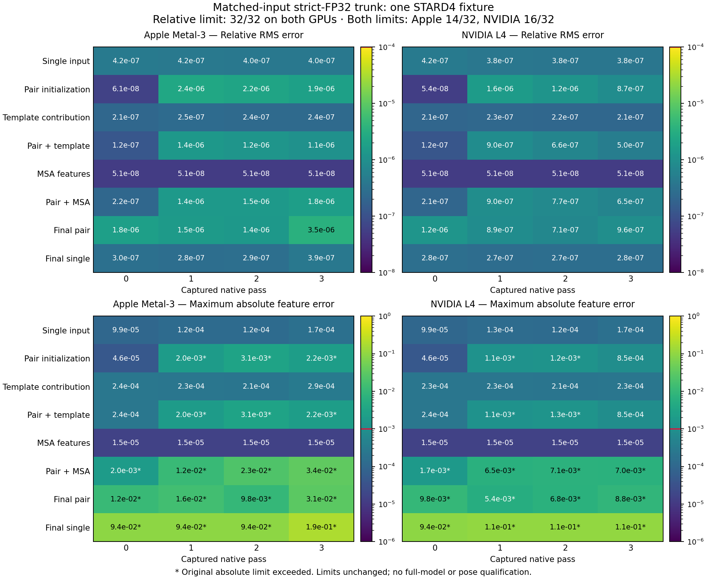

# NVIDIA L4: matched-input FP32 trunk comparison

**All 32 NVIDIA boundaries are finite and pass the original relative-error
limit. Sixteen pass both original limits.** This is close numerical agreement
for the tested feature-processing trunk, with retained absolute-error failures.
The cause of the complete binding-pose disagreement remains unresolved.

| Strict-FP32 control | Both limits pass | Relative limit passes | Worst relative RMS | Worst absolute error |
|---|---:|---:|---:|---:|
| Apple Metal-3 | 14/32 | 32/32 | 3.49 × 10⁻⁶ | 0.1875 |
| NVIDIA L4 | 16/32 | 32/32 | 1.58 × 10⁻⁶ | 0.109375 |

The limits remain relative RMS ≤10⁻⁴, maximum absolute difference ≤10⁻³ and
finite values, frozen before the experiment. Neither GPU passes the complete
combined qualification. These are model-feature values, not ångströms or energies.



## Controlled scope

This is one native-positive OpenBind-0 / OpenFold3 0.5.1 STARD4 fixture
(9T51/A1JTM), separate from the 480-prediction stock Boltz-2 study. Each of four
passes receives captured native inputs, including actual sampled MSA values
and full-FP32 trained weights; eight complete output arrays are checked per
pass. These are 32 boundaries of one system, not 32 independent target cases.
Native feature preparation, capture and conversion were reused.

Job 20535 ran on a genuine NVIDIA L4 with driver 550.90.7, Chrome 157, matched
container/producer source and verified fixture access. The physical backend
passed its integer probe before calculation. The producer set
`pairMatrixKernels:false` and rejected FP16 shader types: all 96 observed shader
sources passed that guard. The [original measurement receipt](strict-fp32/measurement-receipt.json)
records every shader hash and complete output hash. The corresponding Apple
control observed 56 unique shader sources; 37 hashes are shared. Device-selected
generated code differs, so the comparison does not isolate compiler behavior.

Direct NVIDIA/Apple comparison gives a worst relative RMS difference of
2.96 × 10⁻⁶ and maximum absolute difference of 0.15625 across these saved arrays.
Those descriptive values have no additional acceptance limit. In a largest-error
NVIDIA/native entry, 118887.5 becomes 118887.609375: a difference of 0.109375, or
14 float32 steps at that magnitude. This explains the scale of that entry;
it does not replace the original absolute limit or qualify the full output.

Native features are supplied directly. Original browser-generated reference
inputs, denoising, confidence, production quantization and complete sampling
remain separate checks. The raw receipt includes instrumented timing with
boundary readbacks; it is not a whole-model throughput or native-speedup result.

## Complete measurement, failed numerical gate

The browser saved all 32 arrays and exited successfully. The independent
numerical checker then returned failure because 16 boundaries exceed the
original absolute limit; Slurm therefore records `FAILED 1:0`. This outcome is
a completed measurement with a failed qualification, rather than a setup failure.

A separate replay streamed and SHA-checked **645,593,088 raw bytes**, verified
the native and Apple input/output hashes, and recomputed every metric using
float64 reductions. All producer metrics reproduce. It made zero neural calls
and wrote no large local array copies. [Independent results](strict-fp32/independent-replay.json),
[consumed replay source](strict-fp32/consumed-independent-replay.py) and
[runtime provenance](strict-fp32/runtime-provenance.json) remain attached.

## Raw arrays and public replay

The [verified release index](strict-fp32/raw-evidence.json) lists eight public
parts of a **647,319,566-byte ZIP**, SHA-256
`44656a2ba5bedffe32159265960d980d1c191e00b792fc655fb5d1d3cea6af82`.
Each part's local digest matched GitHub's server digest, and the concatenated
transferred bytes matched the complete archive digest. The ZIP has 264 regular
members: all measured arrays, original receipts, consumed source, attribution
and the independent replay. It reuses the previously published native fixture.

For example, this downloads, verifies and joins the public parts using only
Python's standard library (run from the repository root, with a new output file):

```python
import hashlib, json, urllib.request
index = json.load(open("reviews/cofold-feature-parity-2026-11-13/trained-trunk-nvidia/strict-fp32/raw-evidence.json"))
whole = hashlib.sha256()
with open("nvidia-strict.zip", "xb") as out:
    for part in index["parts"]:
        digest, size = hashlib.sha256(), 0
        with urllib.request.urlopen(part["url"]) as response:
            for block in iter(lambda: response.read(1024 * 1024), b""):
                out.write(block); whole.update(block); digest.update(block)
                size += len(block)
        assert size == part["bytes"] and digest.hexdigest() == part["sha256"]
assert whole.hexdigest() == index["archiveSha256"]
```

After extracting that ZIP into `NVIDIA`, reuse `ORIGINAL/fixture` from the
[original native/Apple archive](../trained-trunk-apple/README.md#exact-arrays-and-offline-replay).
The existing checker needs no GPU, checkpoint or neural computation:

```sh
python folding/comparison/check_trained_trunk.py \
  --fixture ORIGINAL/fixture --measured NVIDIA/measurement \
  --output NEW_NVIDIA_ANALYSIS.json
```

It reproduces the failed combined qualification and intentionally exits 1.
The fixture receipt must be
`36a7afd397e001a5f6628d79e1eb754706a15bfc4f2ac836aacb686122f78125`.

## Remaining control

The default-pair-arithmetic / 126-configuration transition control remains
**unmeasured**. Jobs [20534](default-control-unstarted-20534.json) and
[21112](default-control-unstarted-21112.json) both ended `NODE_FAIL` before
payload startup, with no calculation marker or numerical output. The second
was a single bounded recovery with unhealthy nodes explicitly excluded; its
node still failed before startup. No further automatic retry is running.
Those infrastructure outcomes are preserved separately from the completed
strict-FP32 result. The next scientific controls require a stable allocation;
no original tolerance or hardware gate has been relaxed.
