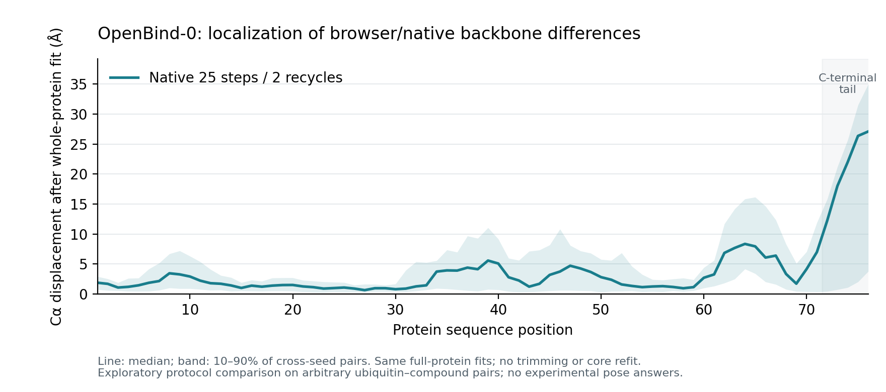

# Cofolding method comparison — 12 November 2026

This record extends the [completed browser library experiment](../library-cofolding-2026-11-12/README.md)
with Boltz-2 and independent native reference computations. It uses the same
ubiquitin sequence, 16 compounds and three seeds per compound (48 poses per
method/protocol). These are arbitrary protein–ligand pairs with no experimental
bound-pose answers. This is an engineering comparison of predicted complexes,
not a test of binding, affinity or pose accuracy.

## Completed browser runs

Both models use the pinned LocalFold source, int5 weights, single-sequence input,
25 sampling steps and two additional recycles, on the same Apple M1 Pro. The
original OpenBind-0 predictions are reused unchanged.

| Browser model | Completed | Queue wall time | First pose | Warm mean per pose |
| --- | --- | --- | --- | --- |
| OpenBind-0 | 48/48 | 135.31 s | 12.00 s | 2.62 s |
| Boltz-2 | 48/48 | 185.91 s | 29.11 s | 3.33 s |

Boltz-2's measured peak managed GPU-buffer allocation was 812,937,340 bytes;
post-pose allocation stayed at 19,847,232 bytes / 16 buffers. These instrumented
buffer counts exclude driver/compiler memory. First use includes downloads and
compilation; warm wall times include per-pose preparation and local persistence.
These are one-machine measurements, not a throughput guarantee.

Raw records:

- [Original OpenBind-0 library](../library-cofolding-2026-11-12/library-48/library-1.json)
- [Boltz-2 library](browser-boltz2/library-1.json), [timings and provenance](browser-boltz2/throughput.json), and [tested build manifest](browser-boltz2/build-manifest.json)
- [All 96 browser poses for Foldarium review](browser-comparison.library.json); import this JSON into the Molarium-hosted Foldarium reviewer. It starts with no preferences.
- [Every cross-seed pair and metric](browser-agreement.json)

OpenBind-0 and Boltz-2 are different trained models. After protein Cα alignment,
their median per-compound mean ligand RMSDs were 16.61 Å for seed-paired poses,
11.81 Å for directed nearest-of-three poses and 15.51 Å for one-to-one ensemble
matching. These substantial differences show why inspecting multiple models and
seeds is useful; they neither identify a correct model nor measure a porting error.
Each ligand moves with its own predicted protein; it is never independently fitted.

## Independent native reference

The native **Boltz-2 low-step run completed all 48 poses** on an NVIDIA L4 Spot
GPU, using the unquantized official checkpoint and BF16 mixed precision. CLI wall
time was 290.87 s; the median synchronized model forward took 2.46 s (mean 3.09 s).
Peak PyTorch allocated/reserved GPU memory was 2,139,282,432 / 2,363,490,304 bytes.
CLI time includes model loading, CPU preparation and output, but excludes queueing,
installation, checkpoint download and hashing. Different hardware and timing
boundaries prevent interpreting browser/native wall-time ratios as a speedup.

| Boltz-2 browser versus native low-step | Median across 16 compounds |
| --- | --- |
| Mean seed-paired ligand RMSD | 12.50 Å |
| Directed nearest-of-three ligand RMSD | 8.53 Å |
| One-to-one ensemble ligand RMSD | 10.48 Å |
| Browser within-method mean seed-to-seed ligand RMSD | 12.94 Å |
| Native within-method mean seed-to-seed ligand RMSD | 10.64 Å |

Median protein Cα RMSD over all 144 cross-seed comparisons was 0.79 Å. The
receptors are much more similar than ligand positions. Substantial ligand
variation also occurs between seeds of each implementation; the cross-engine
differences cannot be attributed solely to porting error. These small ensembles,
arbitrary pairs and unmatched random streams do not establish numerical parity.
Mean ipTM was approximately 0.70 in both routes; a confidence score alone is not
evidence that these arbitrary compounds bind ubiquitin.

- [Browser/native Foldarium review library](boltz2-browser-native.library.json), with all 96 complexes and no selections
- [Complete per-compound/pair results and seed-spread controls](boltz2-low-step-agreement.json)
- [Converted native library](native-boltz2-low-step/library.json) and [public receipt](native-boltz2-low-step/receipt.public.json)
- [Original mmCIFs, native input graphs, consumed source/configuration and forward timings](native-boltz2-low-step/native-artifacts.zip)

The public receipt omits only the CLI argument vector containing private absolute
paths, preserving the original receipt hash. Each native output and cached input
graph retains its hash. The archive's named chemical graphs are safe JSON exports
of the native RDKit caches; original caches/operational receipts remain preserved
with the completed compute attempt. Analysis and human review can be reproduced
directly from the portable libraries without model inference or pickle loading.

The **native OpenBind-0 FP32 control also completed all 48 poses** on Tesla T4
Spot, through official OpenFold3 0.5.1 and its upstream dense-PyTorch triangle
kernels. It kept 25 steps/two recycles and unquantized FP32 weights. CLI wall time
was 262.55 s; median synchronized model forward 3.18 s (mean 3.58 s). Peak allocated/
reserved GPU memory was 1,558,200,320 / 1,591,738,368 bytes. This small 76-residue
experiment does not qualify larger systems or establish general T4 support.

| OpenBind-0 browser versus native FP32 | Median across 16 compounds |
| --- | --- |
| Mean seed-paired ligand RMSD | 12.93 Å |
| Directed nearest-of-three ligand RMSD | 9.19 Å |
| One-to-one ensemble ligand RMSD | 10.94 Å |
| Browser within-method mean seed-to-seed ligand RMSD | 7.56 Å |
| Native within-method mean seed-to-seed ligand RMSD | 8.50 Å |

**OpenBind protein agreement remains unresolved:** median cross-seed protein Cα
RMSD was 7.04 Å, versus within-method pair medians of 1.34 Å in the browser and
3.05 Å natively. This differs substantially from the Boltz receptor result. The
current comparison confounds sampler, quantization, features, precision and RNG;
it cannot diagnose the cause or support a numerical-parity claim. Both source
converters select the intended OpenBind-0 checkpoint/EMA weight family
([ported converter](https://github.com/sokrypton/alphafold3/blob/e68d628df1d815cccb48bb1118d8763a594bfa23/converters/openfold3.py),
[native inference loader](https://github.com/aqlaboratory/openfold-3/blob/795e45b03924a8f8ffc72ae50298bd113530b9d3/openfold3/entry_points/experiment_runner.py)); their
actual weights, tensors and random inputs have not been matched elementwise here.
The discrepancy must remain visible while those controls are developed.

An exploratory [residue-level profile](openbind0-residue-profile.json), using the
same 144 whole-protein fits without trimming or refitting a core, localizes the
largest differences to the C-terminal tail (residues 72–76, median displacements
12–27 Å), with another differing region at 62–67. The median across residue-wise
median displacements is 1.88 Å: the global 7.04 Å RMSD does not mean every residue
differs by that amount. The full RMSDs and all per-pair residuals remain reported;
this post hoc diagnostic does not replace them or isolate a porting error.

[SVG](openbind-residuals.svg), [plot receipt](openbind-residuals.plot.json), and
[reproduction command](../../folding/comparison/README.md#reproduce-the-residual-figure).
This figure uses the completed 25-step control; the 200-step cohort is incomplete.

- [OpenBind browser/native Foldarium review library](openbind0-browser-native.library.json), with 96 unscored complexes
- [Complete OpenBind pairwise metrics and seed-spread controls](openbind0-torch-reference-agreement.json)
- [Native library](native-openbind0-torch-reference/library.json), [public receipt](native-openbind0-torch-reference/receipt.public.json), and [raw mmCIFs, consumed configuration/source and timings](native-openbind0-torch-reference/native-artifacts.zip)

The **native Boltz-2 standard run completed all 48 poses** on L4 Spot, using
200 sampling steps, three recycles and BF16 mixed precision. CLI wall time was
802.14 s; median synchronized forward 11.87 s (mean 12.45 s). Peak allocated/
reserved GPU memory was 2,139,280,384 / 2,363,490,304 bytes. Browser-versus-standard
median seed-paired, nearest-of-three and one-to-one ligand RMSDs were 14.86,
11.94 and 13.48 Å. Median protein Cα RMSD over the 144 cross-seed pairs was
0.98 Å. Within-native standard ligand spread was 7.09 Å, compared with 10.64 Å
for native low-step sampling. More native sampling changes the ensemble; it does
not identify a correct bound pose for these arbitrary pairs.

- [Boltz browser/native standard review library](boltz2-browser-standard.library.json)
- [Full browser/standard and native low-step/standard comparisons](boltz2-standard-agreement.json)
- [Native standard library](native-boltz2-standard/library.json), [public receipt](native-boltz2-standard/receipt.public.json), and [original artifacts](native-boltz2-standard/native-artifacts.zip)

**Pending:** OpenBind standard sampling has 46 validated poses preserved across
two interrupted attempts; only compound 015, seeds 1 and 2, remain. A new attempt
requests exactly those two poses with the same 200-step/three-recycle FP32 dense
protocol. This incomplete cohort is not counted as a completed comparison.

The [reproducible protocol and analysis tools](../../folding/comparison/README.md)
document exact releases, trained checkpoint selection, timing boundaries and
metrics. OpenBind-0 uses official OpenFold3 0.5.1 with the OpenBind-0 checkpoint
released with v0.5.0, rather than Foldarium's historical preview-2 method. Boltz-2
uses official Boltz 2.2.1. The comparison includes matching 25-step/two-recycle
controls, 200-step/three-recycle native runs, and an upstream dense-PyTorch FP32
OpenBind control. The inputs remain single-sequence without templates.

The browser's int5 weights, exponential sampler, random streams and feature
generation differ from native execution. Native reference comparison cannot by
itself establish fixed-input numerical parity. Standard native sampling effort
also does not replace a full MSA workflow or experimental pose benchmarking.

## Findings and traceable fixes

1. **Method identity:** browser OpenBind-0, legacy protein-only OpenFold 2 and
   Foldarium's historical native preview-2 adapter are distinct. The new protocol
   pins the intended trained checkpoint without silently upgrading an old ID.
2. **Second browser method:** Boltz-2 now uses its own LocalFold features, bundle
   and confidence head, exposed through both single-prediction and library routes.
   Affinity inference is not exposed. Chemical graph installation remains shared.
3. **Native input contracts:** early attempts failed before inference on the
   OpenFold3 configuration nesting and Boltz's required `.yaml` filename suffix.
   Corrected immutable attempts pass upstream CPU configuration/input preflights
   and reuse the completed environments/checkpoints. A further OpenFold3 startup
   failed before inference because disabling Lightning's progress bar conflicts
   with an upstream progress callback. The corrected generator leaves it enabled;
   a CPU-only preflight inspection was also corrected to read Pydantic fields via
   `model_dump()`. Failed attempts remain preserved, with no accepted poses lost.
4. **Precision:** the Boltz native CLI uses BF16 mixed precision even for the
   low-step control. Receipts and exported labels report actual effective precision.
5. **Pose comparison:** protein-only alignment, ligand graph symmetry and
   carboxylate oxygen equivalence are tested. A ligand-only alignment would hide
   displacement from its receptor, so it is not used.
6. **Human review:** [Foldarium PR #40](https://github.com/rafwiewiora/foldarium/pull/40)
   labels model/backend per pose and marks unavailable native per-pose times
   explicitly. Comparison exports retain source hashes and exact complexes, with
   no copied test-agent preferences or experimental correctness labels.
7. **Native output chemistry:** Boltz mmCIF omits ligand bonds. The converter
   rejected this missing topology; it now reads a separately hashed JSON export
   of the native input chemical graphs, matched by exact native atom names and
   chemical state. Independent exports with the original RDKit 2026.03.2 release
   on cluster and Mac were byte-identical. No bond was inferred from a predicted
   distance, and no native input conformer was claimed to have been recovered.
8. **Native host resources:** OpenFold3's default ten data-loader workers and
   compiler subprocesses exhausted the four-CPU node's host-memory grant before
   the first model forward. A new immutable attempt used zero data-loader workers
   and one compiler worker, with unchanged scientific inputs, precision, sampling
   and dense model kernels. It completed 48/48 on T4. The execution settings and
   consumed script are in the native receipt/archive; no resource gate was relaxed.
9. **Spot interruption and retained science:** the 200-step OpenBind run saved
   six valid poses before a managed Spot node failed. The original CLI receipt
   remains interrupted; it is not a completed 48-pose result. The
   [source-side inventory](standard-openbind-stopped-inventory.json),
   [six original structures and consumed inputs/source](standard-openbind-interrupted-six.zip),
   and [missing-only recovery plan](standard-openbind-recovery-plan.json) preserve
   this event. The new native attempt excludes those six and requests only the
   remaining 42. Subsequent GPU-node startup failures occurred before their scripts
   or calculations began; those unconsumed allocations were resubmitted using
   existing qualifications and normal/Spot queues. The replay guard still rejects
   any consumed output directory. Recovery verifies complete transfers, hashes,
   query/seed identities, chemical topology and full-cohort coverage. Tests preserve
   all 48 frozen coordinate hashes across a simulated six-plus-42 interruption,
   and reproduce the real remaining-input digest from the public archive.
10. **Output identity scope:** compound indices are parsed from model filenames,
    and Boltz seeds from paths inside the native attempt. An ancestor directory
    named `compound_999` or `seed-99` must not change pose identity. The frozen
    cohort round-trip exercises an adversarial ancestor name while preserving all
    48 coordinate hashes.

Analysis checks cover rigid transforms, a displaced ligand, conjugated terminal
symmetry, native double-bond identity independent of distance, input-hash rejection,
and duplicate/missing seed rejection. Browser regression checks reuse completed
science; they do not calculate a fresh cohort merely to test review/export.
