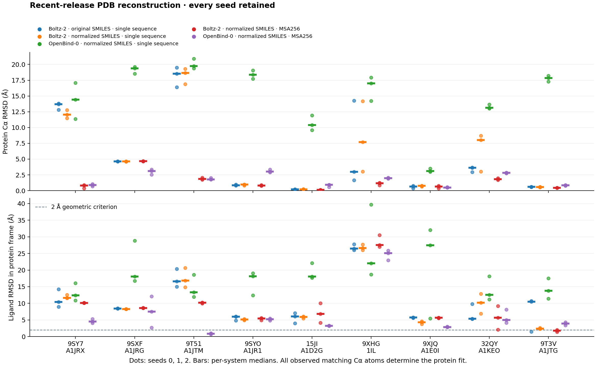
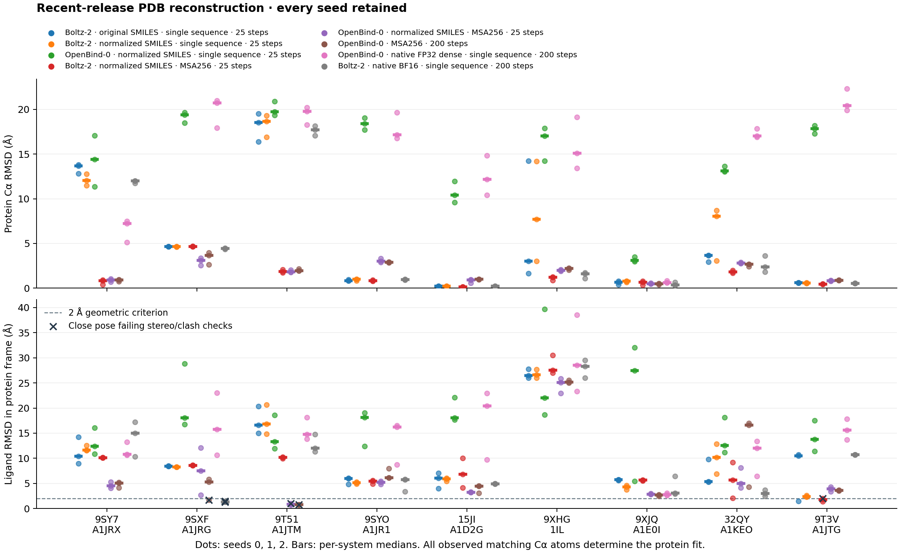

# Recent-release PDB cofolding reconstruction

This Foldarium-inspired experiment asks whether browser cofolding can reconstruct
drug-like complexes from recent PDB releases. Selection used source structures
and fixed chemical/representation gates before any prediction. Every seed is
retained, including incorrect folds and poses. Recent release does not establish
that related proteins, ligands or binding sites were absent from training.

**[Open the Foldarium review](index.html)** to inspect all saved candidates,
record preferences or “none of these”, and export exact poses and decisions.
Prediction-only review and review with a labelled experimental reference have
separate local identities. Reopening the same source bundle preserves decisions;
no preferences are embedded in the public bundles. This review does not rerun
inference. Method/protocol labels remain visible; it is not a blinded trial.

## Selection fixed before inference

The official RCSB query covers initial releases **16 October–13 November 2026**,
X-ray diffraction, and at least one nonpolymer entity. It returned **1,137 entries**
and 2,502 ligand records. The complete metadata harvest had 518 eligible records
before coordinate checks and target diversity. A large NSP3 fragment series
accounted for 469 eligible records on 4 November; sequence diversity prevents it
from dominating the panel.

We reused Foldarium's artifact-component exclusions, pinned to
[b73ac80](https://github.com/rafwiewiora/foldarium/tree/b73ac80d9354dc0f323d7fb54d128f8c1ac0cb8e),
and added explicit RDKit QED ranking. This extends its historical largest-eligible-
ligand policy rather than claiming to reproduce that selection exactly.

The [full policy](panel.json) requires one standard-amino-acid protein entity of
60–350 residues, a connected ligand of 15–60 heavy atoms, molecular weight
150–650, QED ≥0.5, logP −1–6, HBD ≤5, HBA ≤12, rotatable bonds ≤12, absolute
formal charge ≤2, and at least one ring. Resolution must be ≤2.5 Å, observed Cα
coverage ≥90%, and at least four protein residues must contact the ligand at
4 Å. Covalent links, protein–ligand distances under 1.8 Å, another protein chain
within 4 Å, and another nonwater species within 3 Å reject a candidate.

Generated copies in the deposited biological assembly are checked as well as
the asymmetric unit. The v1 asymmetric-unit policy was amended to v2 **before
inference**; the nine selected identities were unchanged. Sequences ≥80%
identical by global alignment are excluded across the panel. We take at most
three systems per release date, ordered by descending QED, then resolution and
identifiers. Missing source files block lower-ranked candidates for that date;
download order cannot silently promote an easier cached candidate.

The [selection audit](selection-audit.json), [ranking](ranking.json),
[complete search response](search-response.json), [harvest receipt](harvest.json),
selected [source files](sources/), and
[complete metadata/source/history archive](selection-evidence.zip) retain the
exclusions and the pre-inference v1→v2 amendment. QED is a selection heuristic,
not a measured pharmacological property. These gates deliberately restrict the
experiment to tasks represented by the current single-chain/one-ligand interface.
More distant partners, waters and crystal packing can still matter scientifically.

## Completed single-sequence browser results

Actual Chrome/WebGPU on Apple M1 Pro with 16 GiB unified memory ran three seeds
(0, 1, 2), int5 weights, 25 sampling steps and two additional recycles. No crystal
coordinates, templates, bound conformers, binding-site restrictions or MSA were
provided in this phase. OpenBind used the public Chemist Actions API; Boltz used
the visible library controls. Both paths use the same application workflow.

The table shows **median ligand heavy-atom RMSD across three seeds** after
fitting every observed matching protein Cα atom. The whole complex moves with
that fit. There is no trimming, pocket/core refit or independent ligand fit.

| System | Release | Protein / observed Cα | Ligand heavy atoms | QED | Boltz original | Boltz normalized | OpenBind normalized |
| --- | --- | ---: | ---: | ---: | ---: | ---: | ---: |
| [9SY7](https://www.rcsb.org/structure/9SY7) · phosphopantetheine adenylyltransferase | 10-21 | 162 / 157 | 19 | 0.921 | 10.41 Å | 11.60 Å | 12.39 Å |
| [9SXF](https://www.rcsb.org/structure/9SXF) · KIT | 10-21 | 327 / 295 | 24 | 0.681 | 8.45 Å | 8.28 Å | 18.07 Å |
| [9T51](https://www.rcsb.org/structure/9T51) · STARD4 | 10-28 | 205 / 204 | 33 | 0.604 | 16.58 Å | 16.81 Å | 13.34 Å |
| [9SYO](https://www.rcsb.org/structure/9SYO) · Hsp90 | 10-28 | 228 / 209 | 22 | 0.557 | 5.95 Å | 5.15 Å | 18.09 Å |
| [15JI](https://www.rcsb.org/structure/15JI) · NSP3 macrodomain | 11-04 | 169 / 167 | 21 | 0.942 | 6.08 Å | 5.86 Å | 18.06 Å |
| [9XHG](https://www.rcsb.org/structure/9XHG) · STING | 11-04 | 192 / 173 | 26 | 0.651 | 26.46 Å | 26.59 Å | 21.99 Å |
| [9XJQ](https://www.rcsb.org/structure/9XJQ) · WDR5 | 11-11 | 304 / 304 | 21 | 0.856 | 5.71 Å | 4.33 Å | 27.49 Å |
| [32QY](https://www.rcsb.org/structure/32QY) · YTHDF2 | 11-11 | 167 / 151 | 18 | 0.592 | 5.36 Å | 10.18 Å | 12.56 Å |
| [9T3V](https://www.rcsb.org/structure/9T3V) · soluble epoxide hydrolase | 11-11 | 344 / 316 | 34 | 0.570 | 10.46 Å | 2.38 Å | 13.80 Å |

Only **1/27** original Boltz poses meets the 2 Å geometric criterion (sEH seed 2,
1.475 Å); **0/27** normalized Boltz and **0/27** normalized OpenBind poses do.
Thus the verified chemistry correction does **not** establish improved pose
accuracy. OpenBind also has substantial protein-fold errors in this protocol.
These outcomes do not isolate port, quantization, sampler, missing evolutionary
information, conformer generation, or model limitations.
Canonical SMILES can reorder atoms and change the seeded input conformer. The
before/after runs therefore do not isolate the aromatic-feature change or prove
a general accuracy regression.



[All per-seed scores](browser-scores.json) include seed 0, medians, confidence-
selected results, oracle best-of-three, contacts, clash diagnostics, tetrahedral
stereochemistry and source/coordinate hashes. Oracle selection uses the crystal
answer and cannot stand in for prospective pose selection. The 2 Å count alone
does not assess complete chemical or physical validity.

Raw phase directories retain all nine libraries, timing/provenance and build
manifests: [original Boltz](browser-boltz2-baseline/throughput.json),
[normalized Boltz](browser-boltz2-normalized/throughput.json),
[normalized OpenBind](browser-openbind0-normalized/throughput.json).
The original runtime code version is `4d5dc7d64436…`; normalized runs use
`3cb821c05b29…`. Exact full hashes remain in every result and phase manifest.
Timing records are observations from a device also used for analysis; they are
not controlled speed comparisons between models or protocols.

## Chemistry findings and fixes

KIT's original aromatic SMILES caused the lightweight parser to mark an
inter-ring single bond aromatic. YTHDF2's equivalent Kekule spelling produced
different raw aromatic/bond feature flags. Sanitized chemical identity alone
misses this distinction. The scorer also initially rejected equivalent spellings
because it matched before normalization.

Molarium now sanitizes/canonicalizes SMILES locally with RDKit WebAssembly before
LocalFold conformer generation and atom features. It records the original and
canonical hashes and RDKit version. It performs no protonation or tautomer
enumeration and uses no experimental coordinates. All nine actual browser input
graphs and specified tetrahedral centres passed an independent Python RDKit
check: [browser records](normalized-chemistry.json),
[independent feature/stereo checks](normalized-chemistry-check.json).
The post hoc [check of all 162 saved input conformers](all-input-conformers.json)
also confirms every specified tetrahedral configuration. Exact expected centre
counts are tested so a graph lacking conformer/stereo information cannot produce
a vacuous pass. Symmetry-equivalent graph mappings are handled explicitly.
Original failed-input baseline predictions remain available. See the
[finding-to-fix ledger](findings.md) for code and regression links.

## Provided-MSA control and native references

A separate controlled phase uses the same nine systems, SMILES, seeds and
sampling settings with saved ColabFold alignments. Each A3M contains the exact
query plus the first unique aligned rows, UniRef before environmental sequences,
up to **256 rows including the query**. Deduplication ignores lowercase
insertions. Neither predictions nor crystal poses select rows. Model-specific
feature construction may prepend its own query row; file row count and model
MSA depth are recorded separately. These files yield 257 stacked rows, including
the model's additional query row, in both the official OpenFold3 processor and
the browser's OpenBind feature path.

The [MSA index](msa256/msa-index.json), [explicit phase protocol](msa256/protocol.json),
[exact inference panel](panel-msa256.json) and [raw search archive](msa256/search-evidence.zip)
retain sequences, alignments, provider tickets and hashes. The inference panel
inherits the original policy/caveats; its per-case A3M and the explicit phase
protocol override the inherited single-sequence mode. Scoring always uses the
unchanged parent references. Both MSA-assisted models completed 27/27 predictions.
All three Boltz sEH poses meet 2 Å (1.38–1.99 Å); OpenBind recovers the three
STARD4 placements (0.69–1.00 Å). Neither model meets 2 Å on another system.
One Boltz sEH pose has a severe heavy-atom clash; one OpenBind STARD4 pose fails
the declared tetrahedral configuration. Thus only two poses per model pass both
the 2 Å criterion and these limited stereo/clash diagnostics. Those checks are
not an exhaustive physical-validity assessment.

| System | Boltz median protein Cα | Boltz median ligand | OpenBind median protein Cα | OpenBind median ligand |
| --- | ---: | ---: | ---: | ---: |
| 9SY7 · PPA | 0.81 Å | 10.13 Å | 0.91 Å | 4.53 Å |
| 9SXF · KIT | 4.66 Å | 8.60 Å | 3.09 Å | 7.52 Å |
| 9T51 · STARD4 | 1.87 Å | 10.20 Å | 1.79 Å | 0.86 Å |
| 9SYO · Hsp90 | 0.82 Å | 5.44 Å | 3.01 Å | 5.19 Å |
| 15JI · NSP3 | 0.13 Å | 6.79 Å | 0.92 Å | 3.23 Å |
| 9XHG · STING | 1.19 Å | 27.56 Å | 1.99 Å | 25.11 Å |
| 9XJQ · WDR5 | 0.65 Å | 5.65 Å | 0.49 Å | 2.84 Å |
| 32QY · YTHDF2 | 1.81 Å | 5.67 Å | 2.81 Å | 4.98 Å |
| 9T3V · sEH | 0.44 Å | 1.76 Å | 0.83 Å | 3.90 Å |

The
[raw MSA-assisted Boltz phase](browser-boltz2-msa256/throughput.json) and
[OpenBind phase](browser-openbind0-msa256/throughput.json), with their per-seed
scores, retain every result. The 200-step/three-recycle controls below are
separate experiments and are not included in these 25-step tables.

### Standard-sampling browser control

OpenBind-0 completed all 27 poses with the same provided MSA256 and normalized
inputs, 200 diffusion steps and three additional recycles. It uses the same
frozen scientific runtime as the 25-step normalized phases. Median protein / ligand
RMSD values are:

| System | Protein Cα | Ligand in protein frame |
| --- | ---: | ---: |
| 9SY7 · PPA | 0.90 Å | 5.03 Å |
| 9SXF · KIT | 3.66 Å | 5.28 Å |
| 9T51 · STARD4 | 1.95 Å | 0.74 Å |
| 9SYO · Hsp90 | 2.89 Å | 6.12 Å |
| 15JI · NSP3 | 0.98 Å | 4.48 Å |
| 9XHG · STING | 2.18 Å | 25.16 Å |
| 9XJQ · WDR5 | 0.48 Å | 2.66 Å |
| 32QY · YTHDF2 | 2.67 Å | 16.58 Å |
| 9T3V · sEH | 0.88 Å | 3.60 Å |

Four poses are within 2 Å: KIT seed 1 and all three STARD4 seeds. KIT seed 1
and STARD4 seed 2 fail the declared stereochemical-identity check. Only two
pass both the geometric criterion and the limited stereo/clash checks, as in
the 25-step OpenBind run. This is not a broad accuracy improvement or a
complete physical-validity assessment. [Raw runs and timing](browser-openbind0-msa256-standard/throughput.json)
and [per-pose scores](browser-openbind0-msa256-standard/scores.json) preserve
all outcomes. These six complete browser phases retain 162 poses, with explicit
model, MSA and step labels. The native controls below add separate predictions.

Boltz-2 standard sampling stopped after browser-storage failures. We preserve
14 unique complete poses from the first five systems in an
[immutable evidence archive](boltz-standard-partial-evidence.zip), with
[source hashes, original run statuses and exact missing-seed inventory](boltz-standard-partial-receipt.json).
Twelve poses on the remaining four systems were not run. NSP3 seed 0 was
reported complete but its coordinates disappeared before any host snapshot
captured them. The earlier handoff misidentified a seed-1 snapshot as preserving
seed 0; inspecting every saved snapshot corrected that claim. This incomplete
phase is not pooled into the full-panel accuracy tables or review. No saved
prediction was recomputed to hide an interruption.

The storage adapter now retries a closed connection once, while quota errors
still stop the queue. Atomic checkpoint writes verify earlier saved results;
if they disappear, execution preserves the current result, records the missing
checkpoints and stops without automatically repeating completed inference.
The regression deletes an actual test IndexedDB database between validation
and write: [finding and linked tests](findings.md). Very low host disk space
was observed during the interrupted run; the exact cause of Chrome's data
loss has not been independently established. Export results regularly: local
browser storage is not a backup.

The **actual official OpenFold3 0.5.1 CPU input processor and stack helper** read
all nine supplied alignments. Its residue and deletion rows exactly match the
browser OpenBind path for every case. Protein residue profiles and deletion means
also agree exactly (maximum absolute difference 0 after the documented alphabet
mapping): [comparison](msa256/openbind-feature-comparison.json),
[official feature export](msa256/official-openbind-msa-features.json),
[source pin and scope](msa256/official-source.json). This isolates one input
boundary, not complete feature, tensor, sampler or model parity. The local CPU
environment is recorded separately from the pending cluster model environment.
The earlier rows-only comparison is preserved in the
[feature-check history archive](msa256/official-rows-only-history.zip).

Native single-sequence OpenBind/OpenFold3 0.5.1 FP32 dense and Boltz 2.2.1 BF16
controls were submitted on PSIgreen with 200 steps and three recycles. Their CPU
input/configuration preflight passed. All **54 native single-sequence poses**
have now been retrieved, checked against a source-side SHA-256 inventory,
converted using explicit native topology and scored against the unchanged
experimental references. They are included in Foldarium: **216 predictions**
across six complete browser phases and two complete native phases.

| System | Native OpenBind protein / ligand median RMSD | Native Boltz protein / ligand median RMSD |
| --- | ---: | ---: |
| 9SY7 · PPA | 7.22 / 10.79 Å | 11.99 / 14.99 Å |
| 9SXF · KIT | 20.74 / 15.78 Å | 4.45 / 1.34 Å |
| 9T51 · STARD4 | 19.80 / 14.80 Å | 17.72 / 12.00 Å |
| 9SYO · Hsp90 | 17.18 / 16.22 Å | 0.96 / 5.75 Å |
| 15JI · NSP3 | 12.16 / 20.46 Å | 0.21 / 4.93 Å |
| 9XHG · STING | 15.12 / 28.50 Å | 1.58 / 28.27 Å |
| 9XJQ · WDR5 | 0.63 / 2.76 Å | 0.34 / 3.05 Å |
| 32QY · YTHDF2 | 17.05 / 12.00 Å | 2.39 / 3.02 Å |
| 9T3V · sEH | 20.44 / 15.60 Å | 0.51 / 10.69 Å |

Native Boltz has three ligand poses within 2 Å, all KIT. **All three disagree
with the declared tetrahedral stereochemistry** (expected R, observed S).
Native OpenBind has no pose within 2 Å and large protein-fold errors for eight
systems. Consequently **0/54** passes both the geometric criterion and the
limited stereochemistry/clash checks. These observations do not establish that
the browser port causes the failures: native input handling, conformers, model,
precision and sampling remain distinct. Native input-conformer selection has
not been reconstructed from the saved molecule cache.



The [combined score file](all-protocol-scores.json) retains each seed and its
original phase. Crosses mark poses within 2 Å that fail the limited stereo/clash
checks; the geometric threshold alone is insufficient.

The [OpenBind raw evidence and scores](native-openbind0-single-standard/evidence.json)
and [Boltz raw evidence and scores](native-boltz2-single-standard/evidence.json)
retain exact native mmCIFs, named graphs, consumed inputs/runner, timing records
and scientific receipts. An independent public-data regression reconstructs
every exported coordinate and all per-pose crystal scores; it never loads
molecule-cache pickle objects. Only private CLI argument paths are omitted from
public receipts; exact original receipt hashes remain attached.

The [all-pairs browser/native comparison](native-single-agreement.json) keeps
every cross-seed pairing and within-method spread. Across the nine systems,
the median seed-paired mean ligand RMSD is 17.36 Å for OpenBind and 8.23 Å for
Boltz; one-to-one ensemble assignment gives 12.12 Å and 7.90 Å respectively.
These compare normalized single-sequence browser 25-step/two-recycle runs with
native 200-step/three-recycle runs. They are not precision-only or matched-RNG
comparisons and do not measure experimental accuracy.

Separate native controls with the **exact saved MSA256 inputs** have passed
official CPU feature preflight on PSIgreen. Those separate results are not yet
included or counted as complete phases here. No new standalone VM, priority
change or cap bypass is used.
Equal integer seeds do not match random tensors. These controls compare complete
prediction protocols; they do not establish fixed-tensor numerical parity.

## Reproduce

Install [analysis dependencies](../../folding/comparison/requirements-analysis.txt)
in an isolated environment. Selection can be repeated from the archived metadata
and sources without fetching or running any model:

```sh
python folding/comparison/recent_pdb.py rank --entries /path/to/entries.json --output /tmp/new-ranking.json
python folding/comparison/recent_pdb.py prepare --ranking /tmp/new-ranking.json --sources /path/to/sources --output /tmp/new-preparation
python folding/comparison/validate_ligand_inputs.py --report reviews/cofold-recent-pdb-2026-11-13/normalized-chemistry.json --output /tmp/input-check.json --strict
python -m unittest discover -s folding/comparison -p 'test_*.py'
```

The live harvester is `folding/comparison/harvest-recent-pdb.mjs`; it requires an
explicit date window and rejects truncated/duplicate metadata. Source-selection
orchestration is bounded and keeps immutable preparation attempts. `experimental_reference.py score`
recomputes pose scores from saved libraries; `build-panel-reviews.mjs` rebuilds
both review variants from `panel.json` and `phases.json`. Neither performs inference.
`plot_panel_results.py` recreates the figure from the score JSON.

For a genuinely new browser experiment, use an unused output directory:

```sh
MOLARIUM_LIBRARY_PANEL=reviews/cofold-recent-pdb-2026-11-13/panel.json \
MOLARIUM_LIBRARY_REPORT=/tmp/new-recent-boltz-attempt \
bun scripts/cofold-library.browser.mjs --boltz2
```

Use `panel-msa256.json` for the provided-MSA phase. Omit `--boltz2` for OpenBind;
set `MOLARIUM_LIBRARY_USE_API=1` to exercise the public action. Existing science
needs no recomputation for inspection. Host checkpoints preserve each completed
pose while a run is active. Raw bundles carry no human preferences.
