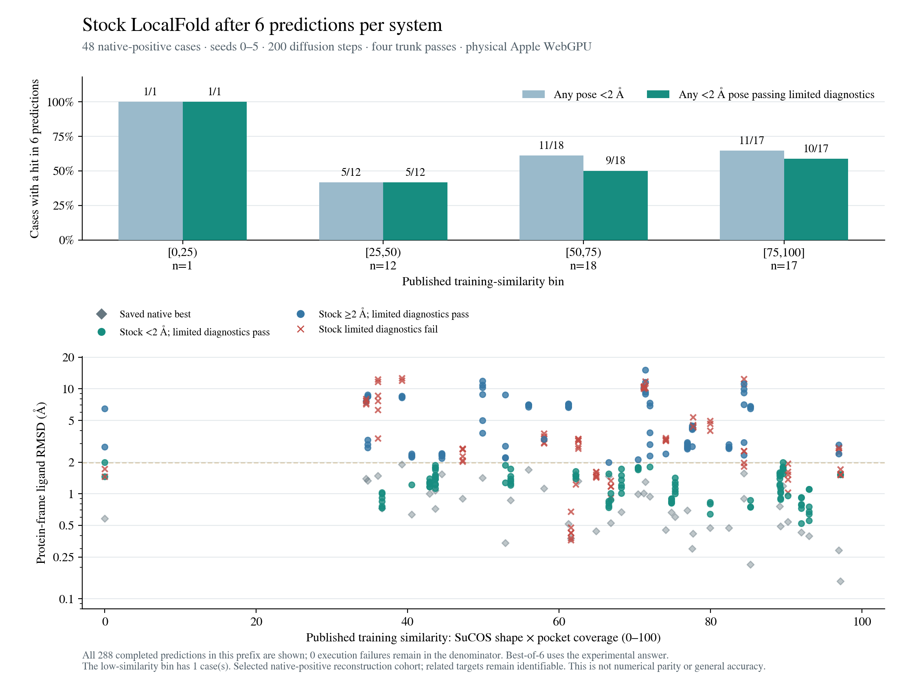
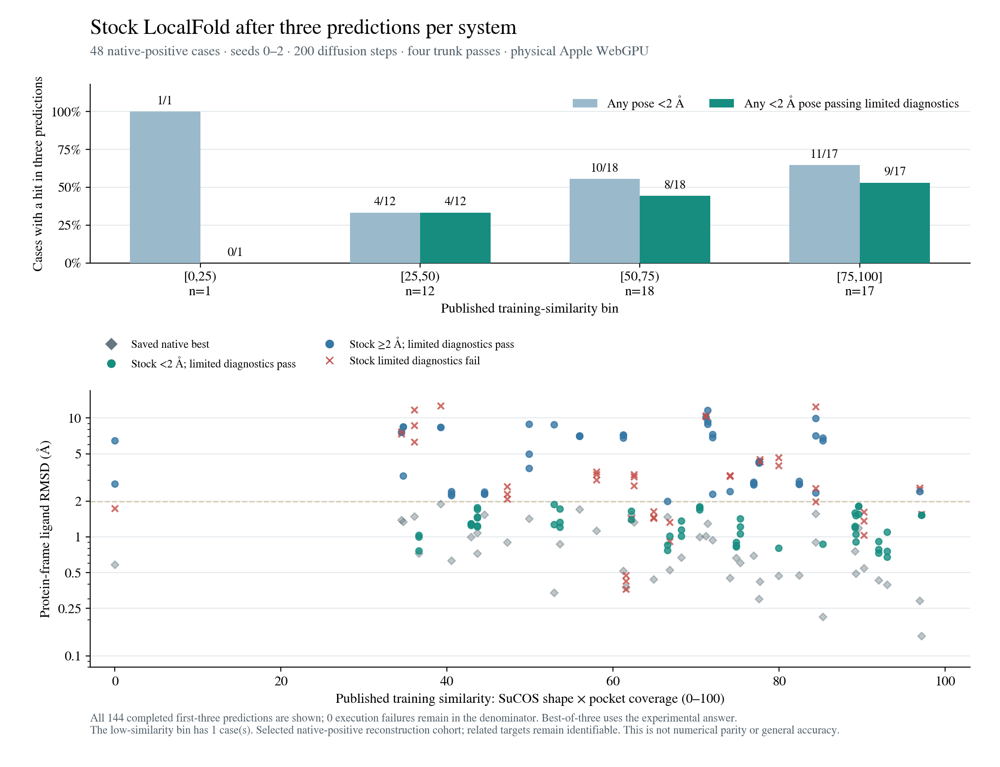

# Runs N’ Poses: larger native-positive stock LocalFold comparison

**Status: the 480-prediction stock benchmark is running. The verified checkpoint contains 288 completed predictions: six samples for every case. A continuation is running after a host restart.**
The complete published-alignment archive passed its checksum. All 480 inputs
were frozen before the first new neural prediction, using the query and up to
255 unique published alignment rows. The single guarded batch is running on
physical Apple Metal-3 WebGPU through the pristine original LocalFold page.
The frozen plan SHA-256 is
`797454ec8d2766485a96cfb13326511f0333efa7b89bb656968f84b2844ad349`.

[The independently replayed 288-prediction checkpoint](checkpoint-288/README.md)
retains every planned prediction in its denominator. Uniform completed sample
budgets are reported separately; the final ten-sample result remains pending.
The [221-prediction checkpoint](checkpoint-221/README.md) remains preserved.
The existing [completed 80-prediction study](../cofold-stock-localfold-2026-11-13/results-200x10/README.md)
remains a separate cohort.

The public [Runs N’ Poses dataset](https://zenodo.org/records/18366081) and
[repository](https://github.com/plinder-org/runs-n-poses/tree/197fafc60a5cef3a9e7f8a4b0dac7c965eed3839)
provide experimental complexes, actual sequence/SMILES declarations and published
Boltz-2 predictions. We reuse these predictions rather than rerunning native
inference. We first screen for published native RMSD <2 Å, then independently
score saved native coordinates against the experimental ligand in the frame of
**all observed corresponding protein C-alpha atoms**. There is no pocket fit,
trimming, or independent ligand alignment.

| Stage | Cases | Comment |
|---|---:|---|
| Frozen representable candidate pool | 147 | One canonical protein, one connected 15–60-heavy-atom ligand, 60–700 residues, release after 1 June 2023 |
| Independent native qualification | 113 | At least one rescored saved Boltz-2 pose strictly below 2 Å |
| Selected follow-up | 48 | Stable hash order; at most two cases per exact sequence and three per supplied RnP cluster |
| Distinct selected protein sequences / clusters | 43 / 36 | Related cases remain identifiable |
| Selected cases with a stereo/clash-passing native hit | 41 | Seven geometric-only successes remain flagged separately |
| Verified new browser checkpoint | 288/480 | First six seeds complete for all 48 cases; full ten-seed result remains pending |

| Training-similarity bin | Candidate pool | Native-qualified | Selected | Predeclared target |
|---|---:|---:|---:|---:|
| [0,25) | 3 | 1 | 1 | 3 |
| [25,50) | 20 | 17 | 12 | 12 |
| [50,75) | 81 | 63 | 18 | 18 |
| [75,100] | 43 | 32 | 17 | 17 |

Similarity is the published `sucos_shape_pocket_qcov_2023`: ligand SuCOS shape
similarity times pocket coverage to a closest training system before 1 June
2023. It is **not sequence identity**. We retain the two-case low-bin shortfall
instead of filling it with higher-similarity cases. The other two low-bin
candidates fail exact reference-SDF versus inference-input chemical-state
agreement. Across all 147 candidates, 17 fail that chemical-state gate, 11
contain unsupported modified protein residues, and six have no independently
rescored full-frame native hit. Exclusions and all selection decisions are saved.

## Six predictions per system

All 48 cases have completed seeds 0–5, with no recorded terminal execution failures. There is a geometric <2 Å hit in 28/48 cases and a hit passing the limited stereo/clash diagnostics in 25/48 (52.08%). Selecting the highest archived ipTM with the fixed lowest-seed tie rule gives 17/48 (35.42%) passing hit cases. In the subset with a diagnostic-passing native hit, 23/41 cases contain any passing browser hit. The ten-sample result remains pending.

| Uniform samples per case | Any geometric <2 Å hit | Any passing <2 Å hit | Highest-ipTM passing <2 Å hit |
| ---: | ---: | ---: | ---: |
| 3 | 26/48 | 21/48 | 16/48 |
| 6 | 28/48 | 25/48 | 17/48 |

The [complete checkpoint](checkpoint-288/README.md) includes the sampling curves, recorded run times, source-attempt histories and every original output. Reported ipTM has 26 highest-score ties, four of which mix passing hits and other poses. Of eight cases where the fixed selection misses an available passing hit, three involve a top-score tie and five have only strictly lower-scoring passing poses. The [six-sample diagnostic table](checkpoint-288/diagnostics-first6/README.md) records the actual seeds. These are descriptive outcomes of the selected reconstruction cohort, not general accuracy or matched-input numerical parity.

## Historical three-sample checkpoint

All 48 selected cases have completed seeds 0–2. Of these, 26/48 have a geometric <2 Å hit and 21/48 (43.75%) have a hit passing the limited stereo/clash checks. Restricting to the 41 cases with a diagnostic-passing native hit gives 19/41 passing browser hit cases. These retrospective best-of-three counts use the experimental answer and are separate from confidence-based pose selection. The complete ten-seed result is still pending.

The source files, full per-case table and similarity-bin denominators are in the [checkpoint report](checkpoint-221/README.md). The lowest-similarity bin has only one case. An interrupted attempt and its fresh continuation are recorded in [execution history](execution-history.json); none of the first 221 completed predictions was repeated.

Selecting the highest reported ipTM without the crystal answer gives 16/48 passing hit cases after three samples, compared with the crystal-informed 21/48. The [sampling and timing analysis](checkpoint-221/README.md#uniform-sampling-and-confidence-selection) reports every uniformly completed prefix separately. Recorded launcher time has a median of 110.9 seconds across this checkpoint; this includes browser startup, available asset loading and output checks, rather than just GPU computation.

The archived confidence is rounded to two decimals: 19 cases have multiple seeds tied for highest reported ipTM. Three of the five cases with a passing hit that the fixed tie rule does not select have a passing pose tied at the top score; only two have strictly lower reported confidence. The [case-level diagnostic breakdown](checkpoint-221/diagnostics-first3/README.md) distinguishes these observations. The 16/48 result uses the stated lowest-seed tie rule and does not reconstruct the original unrounded confidence values.

The first-three cases partition into 16 selected passing hits, five passing hits not selected, five cases whose only <2 Å poses fail the limited diagnostics, and 22 cases with no <2 Å pose. All five geometric-only cases have stereochemical-identity failures among those near-native poses. In 21 confidence-selected poses, global protein Cα RMSD is below 2 Å while ligand RMSD is at least 2 Å. This shows why a close protein backbone alone does not verify ligand placement; it does not establish a preparation, precision or kernel cause.

## Inspect the original poses

[Portable Foldarium review files](checkpoint-288/review-examples/README.md) cover the five cases where the first-three selection missed an available passing pose, with six saved predictions per case. Import a downloaded JSON into the existing Molarium Foldarium reviewer to rotate poses, compare pockets, and save local preferences or notes. Each case has separate prediction-only and experimental-reference files; no benchmark labels or preferences are embedded. These examples were chosen after seeing the results and are not a blinded or representative study.

The exports preserve every original prediction PDB string and explicit ligand graph. The viewer's Cα alignment was checked against the analysis for all 30 unique predictions, and the actual file-import, molecular rendering, preference persistence and reference separation were exercised without inference. Recorded launcher time remains provenance, rather than being labelled isolated inference time in the viewer. Source attribution travels with each portable library.

A [whole-cohort export preflight](checkpoint-288/all-cohort-review-preflight.json)
also passed for all 288 saved predictions across all 48 systems: 96 separate
prediction-only/reference-inclusive libraries, original graph/PDB identity, and
display alignment within 1.4 × 10⁻¹⁴ Å of the scoring frame. This is a data-only
export/alignment check, not additional inference or a claim that all 48 imports
were individually exercised in the browser. The final reporting phase will
prepare the same coverage with all ten planned samples after independent
verification; the final result remains pending.

## Stock input preparation check

All 48 raw SMILES prepare through the pristine stock `smilesComponent` defaults,
and their named chemical graphs match the declared inputs. The independent
stereochemical-graph diagnostic passes for 45/48 initial conformers. It flags
`8aqf__1__1-a__1-b`, `8iqt__1__1-a__1-b` and `9f40__1__1-a__1-q`; these are input
conformer flags, not folding results. The raw stock preparation is preserved for
all 48, including flagged cases, without changing seeds, rewriting SMILES or
replacing cases. Exact graphs, coordinates and diagnostics are in
`stock-input-components/`. We will report input and output validity separately.

## Protocol and boundaries

The stock runs use the pristine original LocalFold page at
`5ea3d42c911949700401b54003cb28c557fcf2a6`: Boltz-2, ten seeds (0–9), 200 diffusion
steps and three additional recycles (four trunk passes). Inputs retain the
query plus up to the first 255 unique rows from the published protein alignment. No
experimental coordinates or restraints enter stock inference. The published
native runs used their own settings and alignments; this is a reconstruction
comparison conditioned on native success, **not matched-input numerical parity
or a general accuracy benchmark**. Different native and browser sampling budgets
and model quantization must remain explicit.

RnP’s Boltz CSV uses `method=boltz` for both Boltz generations. We select the
exact `predictions/boltz2.csv` archive member; selecting by that ambiguous column
would mix methods. Both complete source archives were checksum-verified while
streaming. The extractor retained 3,210 published native-hit CIFs and 588 reference
files; the 39.5 GB compressed native archive was not retained. Chemical/reference
gates permit rescoring 2,569 of those poses. Only those saved published-hit poses
were rescored; “nativeBestA” means the best independently rescored pose in that
subset, not a new search over every published prediction.

**Native ligand topology limitation:** the published Boltz mmCIF does not include
ligand bonds, and the processed native RDKit cache is absent. We reconstruct
names from the exact declared SMILES using Boltz’s deterministic
`MolFromSmiles → AddHs → CanonicalRankAtoms → element/rank names → RemoveHs` rule,
preserved from tag v2.2.1, commit `cb04aeccdd480fd4db707f0bbafde538397fa2ac`. Names and
elements must match bijectively. No predicted distances or experimental RMSD
choose the mapping. This is explicitly reconstructed input topology; we do not
claim recovery of the original native cache or knowledge of its historical
RDKit version. The older strict native-cache converter is unchanged.

Stereo and <1.2 Å protein–ligand heavy-atom clash diagnostics are limited checks,
not full PoseBusters validation or a binding-affinity estimate. Geometric and
chemically flagged outcomes stay separate.

## Files and reproduction

- `candidate-pool.json`: frozen inputs, source hashes, model/cutoff/size gates and stable order.
- `native-qualification.json`: independently rescored saved poses, exclusions, diagnostic flags and source/script hashes.
- `selection.json`: selected cases, every rejected selection, caps and shortfalls.
- `references/`: portable reference molecular states for the selected cases.
- `reference-sources/` and `native-best/`: original experimental CIF/SDF and the closest rescored native-hit CIF for each selected case.
- `source-evidence/`: complete extraction receipts and member checksums for all retained candidate evidence.
- `sources/`: pinned source metadata, input-preparation notebook, naming implementation and licenses.
- `environment.txt`: exact analysis package versions.
- `frozen-stock-plan.json`: all 480 job identities and input hashes, frozen before inference.
- `initial-snapshot/`: retained 11-prediction historical snapshot.
- `checkpoint-221/`: 221 independently recomputed predictions, original outputs, device/step receipts and self-contained archive parts containing every frozen input. The summary distinguishes the completed three-seed prefix from the unfinished ten-seed budget.
- `checkpoint-288/`: six samples for every case, independently replayed with original outputs, merged attempt histories, sampling and similarity plots, confidence-tie diagnostics and recorded launcher timings. The six-sample result is distinct from the unfinished ten-sample budget.
- `execution-history.json`: interruption, preserved completed work and immutable continuation.

The scripts in `folding/comparison/` are `rnp_cohort.py`,
`fetch_rnp_evidence.py`, `fetch_rnp_msa.py`, `rnp_qualify.py` and `select_rnp.py`.
`prepare_rnp_components.mjs` preserves original stock ligand preparation;
`prepare_rnp_msas.py` checks the source query and derives the fixed A3Ms;
`prepare_rnp_stock_plan.py` writes every seed-specific input before execution.
`export_stock_review.py` independently verifies a completed snapshot and exports
specified cases in the existing portable Foldarium format without rerunning
models. `check_stock_review.mjs` checks the original PDB and graph hashes,
reference separation, confidence fields and display alignment. CI regenerates
the released examples byte for byte and exercises actual file import and local
preference persistence. The exporter pins its executing source and preserves
explicit dataset attribution in each standalone library.
`wait_rnp_stock.py` can monitor existing assigned jobs, verify the transferred
archive, then start exactly one immutable stock batch. It does not submit remote
jobs or create resources. Remote identity/account configuration stays in a
separate task-local file, and the monitor verifies the guest and Slurm identity
on every check. The wait is bounded; transport failures and failed dependencies
stop it. The batch retains existing source, native-hit and physical-GPU gates,
and stops after three consecutive execution errors.
Full source retrieval requires an allocated CPU job and verifies the entire
official compressed archive checksum. Outputs use fresh immutable directories.
The qualification report records its exact consumed script hashes.
The original candidate selector is saved as `sources/consumed-rnp-cohort.py`;
the current CLI additionally closes the annotation file explicitly. Its generated
candidate records and policy are unchanged.

`check_rnp_selection.py --report reviews/cofold-rnp-spectrum-2026-11-15` checks
the selection and independently rescores all 48 published baseline structures
from the included raw files. `test_rnp.py` covers strict thresholds, model
generation, cutoff, chemical-state mismatch, missing/duplicate atom identities,
coordinate-independent mapping and selection caps.

## Attribution

Source dataset: Peter Škrinjar, Jérôme Eberhardt, Gerardo Tauriello, Torsten
Schwede and Janani Durairaj, *Have protein-ligand cofolding methods moved beyond
memorisation?*, [Zenodo version 18366081](https://zenodo.org/records/18366081),
CC BY 4.0. The files here are selected, reformatted and rescored derivatives;
original-source checksums and processing changes are recorded. Only Boltz-2
outputs are included; AlphaFold3 output restrictions are preserved as source
context and no AlphaFold3 coordinate output is redistributed. The naming source
is from [Boltz](https://github.com/jwohlwend/boltz/tree/cb04aeccdd480fd4db707f0bbafde538397fa2ac),
with its MIT license alongside the snapshot.

## Report tooling findings

The shared snapshot writer previously named KIT/NSP3 and “three saved native
seeds” in fixed prose. It now derives flags from the current frozen cohort and
refers to its actual preserved native evidence. Scores and the executing frozen
batch are unchanged. The evidence checker keeps its original default size and
member limits; larger cohorts may explicitly select a finite artifact budget
(up to 2 GiB / 20,000 members), with all hash, physical-GPU, sampling and rescore
checks retained. `summarize_rnp_stock.py` separates geometric from diagnostic-
passing hits, retains execution failures, and omits final case-hit rates for
unfinished groups.

`analyze_rnp_sampling.py` compares fixed seed prefixes with highest-ipTM selection, without removing invalid poses before ranking. Missing confidence suppresses the corresponding selection rates. Timing observations are hash-bound to the original receipts. The offline checker regenerates the analysis and also checks the confidence values against the original prediction archive. `finalize_rnp_stock.py` can wait for the existing attempts and then merge, rescore, verify and plot all terminal predictions. It cannot submit, restart or repeat science, publish changes, or deploy. It stops on an unfinished stopped batch or a finite wait deadline.

## Combining interrupted attempts without repeating science

`merge_stock_attempts.py` stages completed checkpoints for analysis only; it runs no model. It checks identical consumed source manifests, every frozen input, reference hashes, and completed receipt/output hashes. Later attempts may resolve unfinished predictions, but any overlap with an already completed prediction is rejected. Original progress snapshots and source manifests remain attached. The archive checker verifies that merged completions match those original checkpoints. The interrupted trunk-only attempt is retained in execution history rather than counted as another completed sample.
