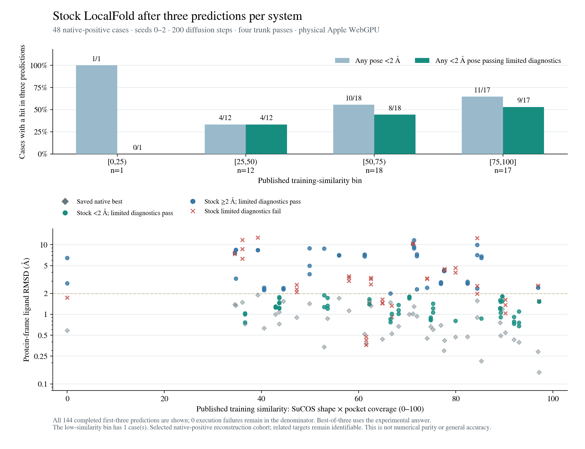

# Stock LocalFold on native-positive crystal cases

**221 of 480 planned predictions completed.** Status: `partial-snapshot`.

Each system/model pair has a frozen budget of **10 model seeds, 200 diffusion steps and 3 additional recycles (4 trunk passes)**. Only cases with a previously saved same-model native pose strictly below 2 Å were selected. This is a selected diagnostic cohort, not an unbiased prospective accuracy benchmark.

| Case | Model | Native best Å | Stock <2 Å / completed | Valid stock hits | Stock best Å | Stock median Å |
| --- | --- | ---: | ---: | ---: | ---: | ---: |
| 8cjg__1__1-a__1-d | boltz2 | 0.58 | 3/5 | 2 | 1.47 | 2.00 |
| 8ou2__1__1-a__1-c | boltz2 | 0.72 | 5/5 | 5 | 1.13 | 1.48 |
| 8j30__1__1-a__1-c | boltz2 | 1.48 | 0/5 | 0 | 3.38 | 7.65 |
| 8cij__1__1-a__1-b | boltz2 | 1.54 | 0/5 | 0 | 2.18 | 2.32 |
| 8chc__1__1-a__1-b | boltz2 | 0.90 | 0/5 | 0 | 2.04 | 2.29 |
| 8aqf__1__1-a__1-b | boltz2 | 1.39 | 0/5 | 0 | 7.34 | 7.67 |
| 8am2__1__1-a__1-d | boltz2 | 1.34 | 0/5 | 0 | 2.75 | 8.45 |
| 7g00__1__1-a__1-q | boltz2 | 0.73 | 5/5 | 5 | 0.73 | 0.91 |
| 8gev__1__1-a__1-b | boltz2 | 0.63 | 0/5 | 0 | 2.24 | 2.32 |
| 7u8x__1__1-a__1-b | boltz2 | 1.43 | 0/5 | 0 | 3.79 | 8.88 |
| 8i2n__1__1-a__1-c | boltz2 | 1.08 | 5/5 | 5 | 1.22 | 1.44 |
| 8pqf__1__1-a__1-c | boltz2 | 1.90 | 0/5 | 0 | 8.37 | 8.56 |
| 8geu__1__1-a__1-b | boltz2 | 1.00 | 5/5 | 5 | 1.17 | 1.25 |
| 8swe__1__1-a__1-e | boltz2 | 0.87 | 5/5 | 5 | 1.21 | 1.38 |
| 8pji__1__1-a__1-e | boltz2 | 0.34 | 2/5 | 2 | 1.27 | 2.21 |
| 8pbo__1__1-a__1-c | boltz2 | 1.48 | 4/5 | 4 | 0.74 | 0.86 |
| 7uad__1__1-a__1-b | boltz2 | 0.38 | 5/5 | 0 | 0.36 | 0.43 |
| 8u7w__1__1-a__1-c | boltz2 | 0.67 | 5/5 | 5 | 1.02 | 1.21 |
| 8gcz__1__1-a__1-n | boltz2 | 1.33 | 0/5 | 0 | 2.70 | 3.22 |
| 8px8__1__1-a__1-d | boltz2 | 1.54 | 5/5 | 4 | 1.40 | 1.48 |
| 8q2y__1__1-a__1-c | boltz2 | 0.52 | 0/5 | 0 | 6.79 | 7.02 |
| 7szr__1__1-a__1-g | boltz2 | 0.44 | 5/5 | 0 | 1.44 | 1.47 |
| 9f40__1__1-a__1-q | boltz2 | 0.45 | 0/5 | 0 | 2.42 | 3.24 |
| 8crl__1__1-a__1-c | boltz2 | 1.30 | 0/5 | 0 | 8.91 | 10.23 |
| 8jmo__1__1-a__1-d | boltz2 | 0.94 | 0/5 | 0 | 2.30 | 3.84 |
| 8q34__1__1-a__1-f | boltz2 | 1.70 | 0/5 | 0 | 6.72 | 7.02 |
| 8gdk__1__1-a__1-o | boltz2 | 1.13 | 0/5 | 0 | 3.02 | 3.36 |
| 8bo3__1__1-a__1-b | boltz2 | 0.66 | 5/5 | 5 | 0.82 | 0.84 |
| 8u7x__1__1-a__1-c | boltz2 | 0.53 | 5/5 | 1 | 0.91 | 1.18 |
| 8i0d__1__1-a__1-b | boltz2 | 1.01 | 0/4 | 0 | 10.08 | 10.24 |
| 8efj__1__1-a__1-d | boltz2 | 1.00 | 3/4 | 3 | 1.70 | 1.78 |
| 8iqt__1__1-a__1-b | boltz2 | 0.15 | 4/4 | 2 | 1.52 | 1.52 |
| 8tti__1__1-a__1-e | boltz2 | 0.29 | 0/4 | 0 | 2.41 | 2.54 |
| 8t1y__1__1-a__1-b | boltz2 | 0.43 | 4/4 | 4 | 0.52 | 0.76 |
| 8jby__1__1-a__1-c | boltz2 | 0.30 | 0/4 | 0 | 4.10 | 4.22 |
| 8q2u__1__1-a__1-c | boltz2 | 0.60 | 4/4 | 4 | 1.00 | 1.14 |
| 8a3a__1__1-a__1-b | boltz2 | 0.21 | 1/4 | 1 | 0.87 | 6.60 |
| 8sze__1__1-a__1-c | boltz2 | 0.40 | 4/4 | 4 | 0.68 | 0.93 |
| 8hlj__1__1-a__1-c | boltz2 | 0.49 | 4/4 | 4 | 0.91 | 1.04 |
| 8sx2__1__1-a__1-c | boltz2 | 0.91 | 0/4 | 0 | 2.35 | 8.16 |
| 9f41__1__1-a__1-q | boltz2 | 0.70 | 0/4 | 0 | 2.67 | 2.79 |
| 8usm__1__1-a__1-c | boltz2 | 0.47 | 2/4 | 2 | 0.81 | 2.41 |
| 8t27__1__1-a__1-b | boltz2 | 0.54 | 4/4 | 0 | 1.03 | 1.50 |
| 8b62__1__1-a__1-c | boltz2 | 1.57 | 1/4 | 0 | 1.99 | 6.87 |
| 8a2p__1__1-a__1-b | boltz2 | 1.19 | 4/4 | 4 | 1.55 | 1.74 |
| 8pp8__1__1-a__1-d | boltz2 | 0.42 | 0/4 | 0 | 4.29 | 4.39 |
| 8t9v__1__1-a__1-b | boltz2 | 0.47 | 0/4 | 0 | 2.77 | 2.78 |
| 8gww__1__1-a__1-c | boltz2 | 0.76 | 4/4 | 4 | 1.20 | 1.36 |

Native geometric hits without a separate limited-validity-passing hit: 8j30__1__1-a__1-c / boltz2, 7uad__1__1-a__1-b / boltz2, 8px8__1__1-a__1-d / boltz2, 8crl__1__1-a__1-c / boltz2, 8gdk__1__1-a__1-o / boltz2, 8u7x__1__1-a__1-c / boltz2, 8b62__1__1-a__1-c / boltz2. “Valid” here means the existing stereochemical identity and severe protein–ligand clash checks; it does not assert complete physical validation.

## Pose selection and sampling

| Case | Model | Seed 0 Å | Best of first 3 Å | Highest-ipTM seed | Highest-ipTM pose Å |
| --- | --- | ---: | ---: | ---: | ---: |
| 8cjg__1__1-a__1-d | boltz2 | 2.79 | 1.74 | 3 | 1.47 |
| 8ou2__1__1-a__1-c | boltz2 | 1.48 | 1.24 | 0 | 1.48 |
| 8j30__1__1-a__1-c | boltz2 | 11.71 | 6.31 | 4 | 7.65 |
| 8cij__1__1-a__1-b | boltz2 | 2.29 | 2.29 | 1 | 2.39 |
| 8chc__1__1-a__1-b | boltz2 | 2.08 | 2.08 | 1 | 2.65 |
| 8aqf__1__1-a__1-b | boltz2 | 7.34 | 7.34 | 1 | 7.60 |
| 8am2__1__1-a__1-d | boltz2 | 8.45 | 3.25 | 4 | 2.75 |
| 7g00__1__1-a__1-q | boltz2 | 1.03 | 0.76 | 0 | 1.03 |
| 8gev__1__1-a__1-b | boltz2 | 2.41 | 2.24 | 0 | 2.41 |
| 7u8x__1__1-a__1-b | boltz2 | 8.88 | 3.79 | 1 | 3.79 |
| 8i2n__1__1-a__1-c | boltz2 | 1.22 | 1.22 | 3 | 1.39 |
| 8pqf__1__1-a__1-c | boltz2 | 8.37 | 8.37 | 0 | 8.37 |
| 8geu__1__1-a__1-b | boltz2 | 1.28 | 1.25 | 2 | 1.30 |
| 8swe__1__1-a__1-e | boltz2 | 1.33 | 1.21 | 2 | 1.72 |
| 8pji__1__1-a__1-e | boltz2 | 1.27 | 1.27 | 0 | 1.27 |
| 8pbo__1__1-a__1-c | boltz2 | 0.77 | 0.77 | 1 | 0.86 |
| 7uad__1__1-a__1-b | boltz2 | 0.36 | 0.36 | 0 | 0.36 |
| 8u7w__1__1-a__1-c | boltz2 | 1.36 | 1.02 | 2 | 1.02 |
| 8gcz__1__1-a__1-n | boltz2 | 3.36 | 2.70 | 0 | 3.36 |
| 8px8__1__1-a__1-d | boltz2 | 1.42 | 1.40 | 0 | 1.42 |
| 8q2y__1__1-a__1-c | boltz2 | 6.79 | 6.79 | 3 | 6.79 |
| 7szr__1__1-a__1-g | boltz2 | 1.63 | 1.44 | 0 | 1.63 |
| 9f40__1__1-a__1-q | boltz2 | 2.42 | 2.42 | 1 | 3.29 |
| 8crl__1__1-a__1-c | boltz2 | 8.91 | 8.91 | 1 | 9.36 |
| 8jmo__1__1-a__1-d | boltz2 | 7.32 | 2.30 | 3 | 3.84 |
| 8q34__1__1-a__1-f | boltz2 | 7.05 | 7.02 | 4 | 6.98 |
| 8gdk__1__1-a__1-o | boltz2 | 3.02 | 3.02 | 1 | 3.36 |
| 8bo3__1__1-a__1-b | boltz2 | 0.83 | 0.83 | 2 | 0.90 |
| 8u7x__1__1-a__1-c | boltz2 | 0.91 | 0.91 | 2 | 1.33 |
| 8i0d__1__1-a__1-b | boltz2 | 10.18 | 10.18 | 1 | 10.30 |
| 8efj__1__1-a__1-d | boltz2 | 1.77 | 1.70 | 0 | 1.77 |
| 8iqt__1__1-a__1-b | boltz2 | 1.55 | 1.52 | 0 | 1.55 |
| 8tti__1__1-a__1-e | boltz2 | 2.59 | 2.41 | 2 | 2.41 |
| 8t1y__1__1-a__1-b | boltz2 | 0.78 | 0.73 | 0 | 0.78 |
| 8jby__1__1-a__1-c | boltz2 | 4.24 | 4.19 | 1 | 4.19 |
| 8q2u__1__1-a__1-c | boltz2 | 1.22 | 1.06 | 1 | 1.06 |
| 8a3a__1__1-a__1-b | boltz2 | 6.82 | 0.87 | 3 | 6.74 |
| 8sze__1__1-a__1-c | boltz2 | 0.68 | 0.68 | 1 | 1.10 |
| 8hlj__1__1-a__1-c | boltz2 | 1.05 | 0.91 | 0 | 1.05 |
| 8sx2__1__1-a__1-c | boltz2 | 2.35 | 2.35 | 1 | 7.12 |
| 9f41__1__1-a__1-q | boltz2 | 2.82 | 2.75 | 1 | 2.90 |
| 8usm__1__1-a__1-c | boltz2 | 4.66 | 0.81 | 3 | 0.83 |
| 8t27__1__1-a__1-b | boltz2 | 1.03 | 1.03 | 1 | 1.63 |
| 8b62__1__1-a__1-c | boltz2 | 2.56 | 1.99 | 2 | 1.99 |
| 8a2p__1__1-a__1-b | boltz2 | 1.81 | 1.55 | 2 | 1.81 |
| 8pp8__1__1-a__1-d | boltz2 | 4.48 | 4.29 | 1 | 4.30 |
| 8t9v__1__1-a__1-b | boltz2 | 2.77 | 2.77 | 2 | 2.95 |
| 8gww__1__1-a__1-c | boltz2 | 1.60 | 1.20 | 0 | 1.60 |

Best RMSD is a crystal-informed oracle statistic. Native bests use the frozen saved native evidence identified in the plan; stock bests use the completed part of the predeclared ten-seed set. The first-three statistic is shown only after all three have completed. Confidence selection uses the largest reported ipTM without consulting the crystal; ties select the lowest seed. All samples, errors and geometry diagnostics remain in [scores.json](scores.json).

## Execution and verification

The pristine LocalFold page at `5ea3d42c911949700401b54003cb28c557fcf2a6` executes its own Fold button, SMILES preparation, quantized weights, sampler and confidence head. The Molarium folding wrapper is bypassed. Actual folding devices and browser versions are recorded per prediction. Physical WebGPU is required; numerical settings/tuning are not overridden. Step and recycle counts are read back from the original UI. Inputs contain sequence, declared SMILES and provided alignment only, with no crystal coordinates.

All observed corresponding Cα atoms determine the protein fit. Ligand heavy-atom RMSD allows graph symmetry but no independent ligand fit, pocket fit or trimming. Archived inputs/outputs and native selection evidence are hash-checked and scores are independently recomputed when assembling this snapshot. Equal integer seeds do not imply matched native/browser random tensors. Sampling, input preparation, quantization and hardware differences prevent treating these pose tests as strict implementation parity.

Evidence archive: [part 1](evidence.part-01.bin) · [part 2](evidence.part-02.bin) · [part 3](evidence.part-03.bin) · [part 4](evidence.part-04.bin) · [part 5](evidence.part-05.bin). The checker reassembles the parts automatically. · [Archive hashes](evidence.json)

```sh
python folding/comparison/check_stock_benchmark.py /path/to/this/review
```

## Native topology provenance

Reconstructed input graph. The original processed RDKit cache and exact historical RDKit version were not published; a matching native cache is not asserted.

## Uniform three-seed comparison

All 48 cases have completed seeds 0–2 (144 predictions). With that common budget, 26/48 cases have a geometric <2 Å hit and 21/48 (43.75%) have a hit passing the limited stereo/clash diagnostics. Among the 41 cases with a diagnostic-passing native hit, the corresponding browser count is 19/41. This is a native-positive selected cohort, not population accuracy or strict numerical parity. The full ten-seed run remains unfinished.

| Published similarity | Cases | Any <2 Å hit in first three | Passing hit in first three |
|---|---:|---:|---:|
| [0,25) | 1 | 1 | 0 |
| [25,50) | 12 | 4 | 4 |
| [50,75) | 18 | 10 | 8 |
| [75,100] | 17 | 11 | 9 |

The lowest-similarity bin has one case; its proportion is not a stable estimate of transfer to dissimilar targets. Related sequences and clusters remain identifiable in the frozen selection. All results, including diagnostic failures, are retained.



## Interrupted execution and continuation

The original process stopped during the trunk of prediction 221 before producing a prediction PDB or job archive. The Mac restarted after the last partial log. All 221 completed receipts, scores and output hashes were verified. A fresh immutable attempt resumes at index 221 with the original frozen source, plan and physical-Apple requirement; no completed prediction is rerun. The partial receipt and log remain preserved separately. This interrupted attempt is recorded separately from completed-prediction outcomes and cannot be counted as uninterrupted execution reliability.

The snapshot's generic `running` row records its captured pre-restart state, not a claim that the old process is still active. [Execution history](../execution-history.json) records the interruption and new attempt.
