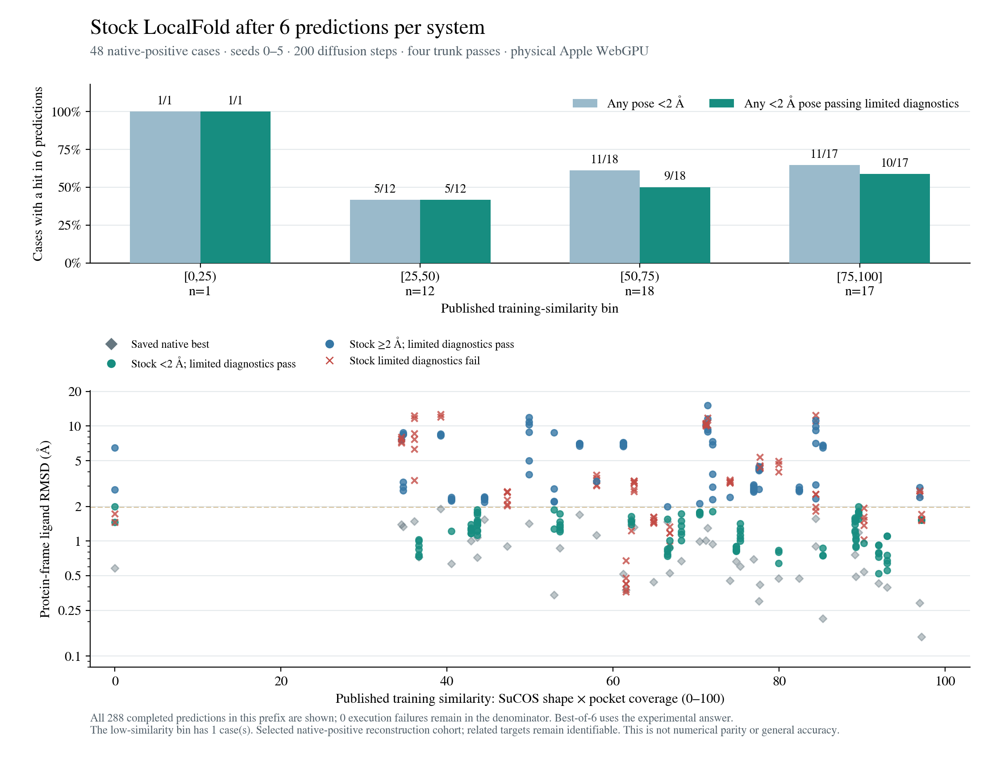
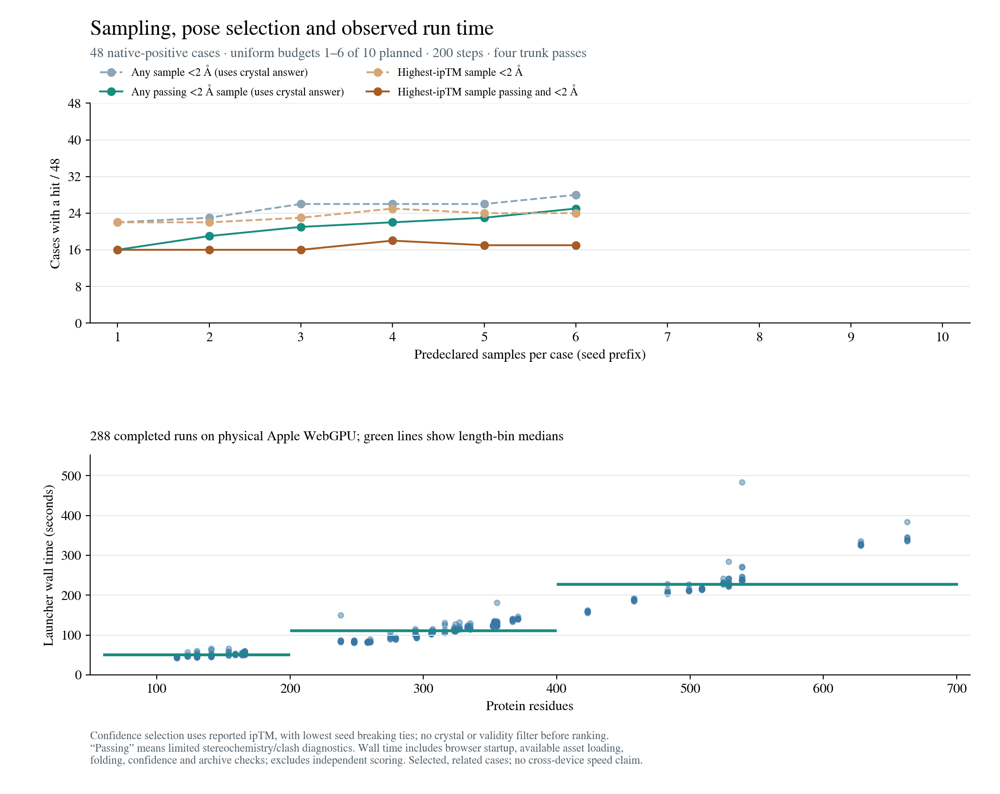
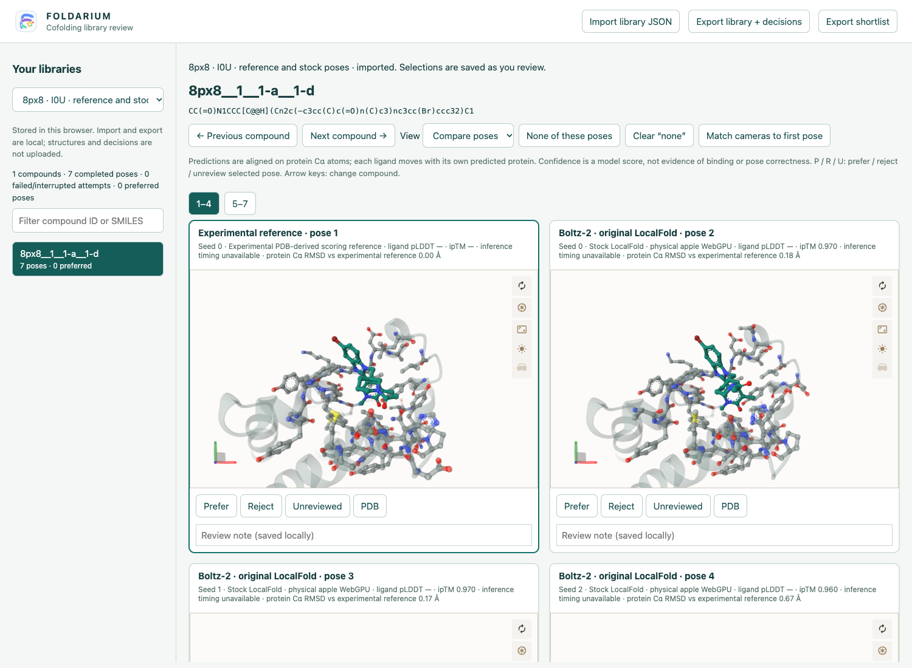

# Stock LocalFold on native-positive crystal cases

**288 of 480 planned predictions completed.** Status: `partial-snapshot`.

Each system/model pair has a frozen budget of **10 model seeds, 200 diffusion steps and 3 additional recycles (4 trunk passes)**. Only cases with a previously saved same-model native pose strictly below 2 Å were selected. This is a selected diagnostic cohort, not an unbiased prospective accuracy benchmark.

| Case | Model | Native best Å | Stock <2 Å / completed | Valid stock hits | Stock best Å | Stock median Å |
| --- | --- | ---: | ---: | ---: | ---: | ---: |
| 8cjg__1__1-a__1-d | boltz2 | 0.58 | 4/6 | 2 | 1.46 | 1.87 |
| 8ou2__1__1-a__1-c | boltz2 | 0.72 | 6/6 | 6 | 1.13 | 1.43 |
| 8j30__1__1-a__1-c | boltz2 | 1.48 | 0/6 | 0 | 3.38 | 8.16 |
| 8cij__1__1-a__1-b | boltz2 | 1.54 | 0/6 | 0 | 2.18 | 2.36 |
| 8chc__1__1-a__1-b | boltz2 | 0.90 | 0/6 | 0 | 2.04 | 2.47 |
| 8aqf__1__1-a__1-b | boltz2 | 1.39 | 0/6 | 0 | 7.18 | 7.64 |
| 8am2__1__1-a__1-d | boltz2 | 1.34 | 0/6 | 0 | 2.75 | 5.85 |
| 7g00__1__1-a__1-q | boltz2 | 0.73 | 6/6 | 6 | 0.73 | 0.88 |
| 8gev__1__1-a__1-b | boltz2 | 0.63 | 1/6 | 1 | 1.22 | 2.30 |
| 7u8x__1__1-a__1-b | boltz2 | 1.43 | 0/6 | 0 | 3.79 | 9.59 |
| 8i2n__1__1-a__1-c | boltz2 | 1.08 | 6/6 | 6 | 1.22 | 1.48 |
| 8pqf__1__1-a__1-c | boltz2 | 1.90 | 0/6 | 0 | 8.22 | 8.46 |
| 8geu__1__1-a__1-b | boltz2 | 1.00 | 6/6 | 6 | 1.17 | 1.26 |
| 8swe__1__1-a__1-e | boltz2 | 0.87 | 6/6 | 6 | 1.21 | 1.35 |
| 8pji__1__1-a__1-e | boltz2 | 0.34 | 2/6 | 2 | 1.27 | 2.20 |
| 8pbo__1__1-a__1-c | boltz2 | 1.48 | 5/6 | 5 | 0.74 | 0.84 |
| 7uad__1__1-a__1-b | boltz2 | 0.38 | 6/6 | 0 | 0.36 | 0.43 |
| 8u7w__1__1-a__1-c | boltz2 | 0.67 | 6/6 | 6 | 1.02 | 1.29 |
| 8gcz__1__1-a__1-n | boltz2 | 1.33 | 0/6 | 0 | 2.70 | 3.23 |
| 8px8__1__1-a__1-d | boltz2 | 1.54 | 6/6 | 4 | 1.23 | 1.45 |
| 8q2y__1__1-a__1-c | boltz2 | 0.52 | 0/6 | 0 | 6.65 | 6.91 |
| 7szr__1__1-a__1-g | boltz2 | 0.44 | 6/6 | 0 | 1.44 | 1.50 |
| 9f40__1__1-a__1-q | boltz2 | 0.45 | 0/6 | 0 | 2.42 | 3.26 |
| 8crl__1__1-a__1-c | boltz2 | 1.30 | 0/6 | 0 | 8.91 | 10.92 |
| 8jmo__1__1-a__1-d | boltz2 | 0.94 | 1/6 | 1 | 1.82 | 3.39 |
| 8q34__1__1-a__1-f | boltz2 | 1.70 | 0/6 | 0 | 6.72 | 7.03 |
| 8gdk__1__1-a__1-o | boltz2 | 1.13 | 0/6 | 0 | 3.02 | 3.35 |
| 8bo3__1__1-a__1-b | boltz2 | 0.66 | 6/6 | 6 | 0.82 | 0.85 |
| 8u7x__1__1-a__1-c | boltz2 | 0.53 | 6/6 | 2 | 0.88 | 1.10 |
| 8i0d__1__1-a__1-b | boltz2 | 1.01 | 0/6 | 0 | 10.08 | 10.32 |
| 8efj__1__1-a__1-d | boltz2 | 1.00 | 5/6 | 5 | 1.70 | 1.77 |
| 8iqt__1__1-a__1-b | boltz2 | 0.15 | 6/6 | 2 | 1.52 | 1.52 |
| 8tti__1__1-a__1-e | boltz2 | 0.29 | 0/6 | 0 | 2.41 | 2.66 |
| 8t1y__1__1-a__1-b | boltz2 | 0.43 | 6/6 | 6 | 0.52 | 0.79 |
| 8jby__1__1-a__1-c | boltz2 | 0.30 | 0/6 | 0 | 2.83 | 4.22 |
| 8q2u__1__1-a__1-c | boltz2 | 0.60 | 6/6 | 6 | 1.00 | 1.17 |
| 8a3a__1__1-a__1-b | boltz2 | 0.21 | 3/6 | 3 | 0.75 | 3.66 |
| 8sze__1__1-a__1-c | boltz2 | 0.40 | 6/6 | 6 | 0.56 | 0.72 |
| 8hlj__1__1-a__1-c | boltz2 | 0.49 | 6/6 | 6 | 0.89 | 1.04 |
| 8sx2__1__1-a__1-c | boltz2 | 0.91 | 0/6 | 0 | 2.35 | 8.16 |
| 9f41__1__1-a__1-q | boltz2 | 0.70 | 0/6 | 0 | 2.67 | 2.86 |
| 8usm__1__1-a__1-c | boltz2 | 0.47 | 3/6 | 3 | 0.64 | 2.41 |
| 8t27__1__1-a__1-b | boltz2 | 0.54 | 6/6 | 1 | 0.96 | 1.45 |
| 8b62__1__1-a__1-c | boltz2 | 1.57 | 2/6 | 0 | 1.83 | 2.57 |
| 8a2p__1__1-a__1-b | boltz2 | 1.19 | 6/6 | 6 | 1.55 | 1.77 |
| 8pp8__1__1-a__1-d | boltz2 | 0.42 | 0/6 | 0 | 4.29 | 4.42 |
| 8t9v__1__1-a__1-b | boltz2 | 0.47 | 0/6 | 0 | 2.71 | 2.77 |
| 8gww__1__1-a__1-c | boltz2 | 0.76 | 6/6 | 6 | 1.20 | 1.44 |

Native geometric hits without a separate limited-validity-passing hit: 8j30__1__1-a__1-c / boltz2, 7uad__1__1-a__1-b / boltz2, 8px8__1__1-a__1-d / boltz2, 8crl__1__1-a__1-c / boltz2, 8gdk__1__1-a__1-o / boltz2, 8u7x__1__1-a__1-c / boltz2, 8b62__1__1-a__1-c / boltz2. “Valid” here means the existing stereochemical identity and severe protein–ligand clash checks; it does not assert complete physical validation.

## Pose selection and sampling

| Case | Model | Seed 0 Å | Best of first 3 Å | Highest-ipTM seed | Highest-ipTM pose Å |
| --- | --- | ---: | ---: | ---: | ---: |
| 8cjg__1__1-a__1-d | boltz2 | 2.79 | 1.74 | 3 | 1.47 |
| 8ou2__1__1-a__1-c | boltz2 | 1.48 | 1.24 | 0 | 1.48 |
| 8j30__1__1-a__1-c | boltz2 | 11.71 | 6.31 | 4 | 7.65 |
| 8cij__1__1-a__1-b | boltz2 | 2.29 | 2.29 | 1 | 2.39 |
| 8chc__1__1-a__1-b | boltz2 | 2.08 | 2.08 | 1 | 2.65 |
| 8aqf__1__1-a__1-b | boltz2 | 7.34 | 7.34 | 1 | 7.60 |
| 8am2__1__1-a__1-d | boltz2 | 8.45 | 3.25 | 4 | 2.75 |
| 7g00__1__1-a__1-q | boltz2 | 1.03 | 0.76 | 0 | 1.03 |
| 8gev__1__1-a__1-b | boltz2 | 2.41 | 2.24 | 0 | 2.41 |
| 7u8x__1__1-a__1-b | boltz2 | 8.88 | 3.79 | 1 | 3.79 |
| 8i2n__1__1-a__1-c | boltz2 | 1.22 | 1.22 | 3 | 1.39 |
| 8pqf__1__1-a__1-c | boltz2 | 8.37 | 8.37 | 0 | 8.37 |
| 8geu__1__1-a__1-b | boltz2 | 1.28 | 1.25 | 2 | 1.30 |
| 8swe__1__1-a__1-e | boltz2 | 1.33 | 1.21 | 2 | 1.72 |
| 8pji__1__1-a__1-e | boltz2 | 1.27 | 1.27 | 0 | 1.27 |
| 8pbo__1__1-a__1-c | boltz2 | 0.77 | 0.77 | 1 | 0.86 |
| 7uad__1__1-a__1-b | boltz2 | 0.36 | 0.36 | 0 | 0.36 |
| 8u7w__1__1-a__1-c | boltz2 | 1.36 | 1.02 | 2 | 1.02 |
| 8gcz__1__1-a__1-n | boltz2 | 3.36 | 2.70 | 0 | 3.36 |
| 8px8__1__1-a__1-d | boltz2 | 1.42 | 1.40 | 0 | 1.42 |
| 8q2y__1__1-a__1-c | boltz2 | 6.79 | 6.79 | 3 | 6.79 |
| 7szr__1__1-a__1-g | boltz2 | 1.63 | 1.44 | 0 | 1.63 |
| 9f40__1__1-a__1-q | boltz2 | 2.42 | 2.42 | 1 | 3.29 |
| 8crl__1__1-a__1-c | boltz2 | 8.91 | 8.91 | 1 | 9.36 |
| 8jmo__1__1-a__1-d | boltz2 | 7.32 | 2.30 | 3 | 3.84 |
| 8q34__1__1-a__1-f | boltz2 | 7.05 | 7.02 | 4 | 6.98 |
| 8gdk__1__1-a__1-o | boltz2 | 3.02 | 3.02 | 1 | 3.36 |
| 8bo3__1__1-a__1-b | boltz2 | 0.83 | 0.83 | 2 | 0.90 |
| 8u7x__1__1-a__1-c | boltz2 | 0.91 | 0.91 | 2 | 1.33 |
| 8i0d__1__1-a__1-b | boltz2 | 10.18 | 10.18 | 1 | 10.30 |
| 8efj__1__1-a__1-d | boltz2 | 1.77 | 1.70 | 0 | 1.77 |
| 8iqt__1__1-a__1-b | boltz2 | 1.55 | 1.52 | 0 | 1.55 |
| 8tti__1__1-a__1-e | boltz2 | 2.59 | 2.41 | 2 | 2.41 |
| 8t1y__1__1-a__1-b | boltz2 | 0.78 | 0.73 | 0 | 0.78 |
| 8jby__1__1-a__1-c | boltz2 | 4.24 | 4.19 | 1 | 4.19 |
| 8q2u__1__1-a__1-c | boltz2 | 1.22 | 1.06 | 1 | 1.06 |
| 8a3a__1__1-a__1-b | boltz2 | 6.82 | 0.87 | 3 | 6.74 |
| 8sze__1__1-a__1-c | boltz2 | 0.68 | 0.68 | 1 | 1.10 |
| 8hlj__1__1-a__1-c | boltz2 | 1.05 | 0.91 | 0 | 1.05 |
| 8sx2__1__1-a__1-c | boltz2 | 2.35 | 2.35 | 4 | 11.19 |
| 9f41__1__1-a__1-q | boltz2 | 2.82 | 2.75 | 1 | 2.90 |
| 8usm__1__1-a__1-c | boltz2 | 4.66 | 0.81 | 4 | 4.95 |
| 8t27__1__1-a__1-b | boltz2 | 1.03 | 1.03 | 1 | 1.63 |
| 8b62__1__1-a__1-c | boltz2 | 2.56 | 1.99 | 2 | 1.99 |
| 8a2p__1__1-a__1-b | boltz2 | 1.81 | 1.55 | 2 | 1.81 |
| 8pp8__1__1-a__1-d | boltz2 | 4.48 | 4.29 | 1 | 4.30 |
| 8t9v__1__1-a__1-b | boltz2 | 2.77 | 2.77 | 2 | 2.95 |
| 8gww__1__1-a__1-c | boltz2 | 1.60 | 1.20 | 5 | 1.55 |

Best RMSD is a crystal-informed oracle statistic. Native bests use the frozen saved native evidence identified in the plan; stock bests use the completed part of the predeclared ten-seed set. The first-three statistic is shown only after all three have completed. Confidence selection uses the largest reported ipTM without consulting the crystal; ties select the lowest seed. All samples, errors and geometry diagnostics remain in [scores.json](scores.json).

## Execution and verification

The pristine LocalFold page at `5ea3d42c911949700401b54003cb28c557fcf2a6` executes its own Fold button, SMILES preparation, quantized weights, sampler and confidence head. The Molarium folding wrapper is bypassed. Actual folding devices and browser versions are recorded per prediction. Physical WebGPU is required; numerical settings/tuning are not overridden. Step and recycle counts are read back from the original UI. Inputs contain sequence, declared SMILES and provided alignment only, with no crystal coordinates.

All observed corresponding Cα atoms determine the protein fit. Ligand heavy-atom RMSD allows graph symmetry but no independent ligand fit, pocket fit or trimming. Archived inputs/outputs and native selection evidence are hash-checked and scores are independently recomputed when assembling this snapshot. Equal integer seeds do not imply matched native/browser random tensors. Sampling, input preparation, quantization and hardware differences prevent treating these pose tests as strict implementation parity.

Evidence archive: [part 1](evidence.part-01.bin) · [part 2](evidence.part-02.bin) · [part 3](evidence.part-03.bin) · [part 4](evidence.part-04.bin) · [part 5](evidence.part-05.bin) · [part 6](evidence.part-06.bin). The checker reassembles the parts automatically. · [Archive hashes](evidence.json)

```sh
python folding/comparison/check_stock_benchmark.py /path/to/this/review
```

## Native topology provenance

Reconstructed input graph. The original processed RDKit cache and exact historical RDKit version were not published; a matching native cache is not asserted.


## Uniform six-sample checkpoint

All 48 cases have completed seeds 0–5: 28/48 have any ligand pose below 2 Å and 25/48 (52.08%) have at least one such pose passing the limited diagnostics. Selecting the highest archived ipTM with the fixed lowest-seed tie rule gives 17/48 (35.42%) passing hit cases. The subset with a diagnostic-passing native hit gives 23/41 cases with any passing browser hit. These are fixed six-sample results; the full ten-sample result is pending.

| Samples per case | Any <2 Å | Any passing <2 Å | Highest-ipTM <2 Å | Highest-ipTM passing <2 Å |
| ---: | ---: | ---: | ---: | ---: |
| 1 | 22/48 | 16/48 | 22/48 | 16/48 |
| 2 | 23/48 | 19/48 | 22/48 | 16/48 |
| 3 | 26/48 | 21/48 | 23/48 | 16/48 |
| 4 | 26/48 | 22/48 | 25/48 | 18/48 |
| 5 | 26/48 | 23/48 | 24/48 | 17/48 |
| 6 | 28/48 | 25/48 | 24/48 | 17/48 |





Archived confidence is rounded to two decimals. 26 cases have multiple seeds tied for highest reported ipTM; 4 of those ties mix passing hits and other poses. Of the eight cases where the fixed selection misses an available passing hit, three have a passing pose tied at the top reported score and five have only strictly lower-scoring passing poses. The [case-level diagnostic report](diagnostics-first6/README.md) distinguishes these observations. They do not reconstruct unrounded confidence or identify a causal implementation defect.

Inputs, all outputs, attempt histories and source hashes remain in the evidence archive. [Machine-readable sampling and timing analysis](selection-analysis.json) and [similarity summary](similarity-summary.json) preserve denominators and suppress unfinished ten-sample rates. This checkpoint reuses completed science and performs no new inference.

## Inspect five diagnostic examples in Foldarium

The [downloadable review libraries](review-examples/README.md) contain six original predictions for each of the five first-three ranking examples. Prediction-only and reference-inclusive views are separate, unscored files with no preassigned choices. Original coordinates and explicit graphs are unchanged, and source attribution remains attached. Importing creates a fresh local library; reopen that saved library to continue its preferences, or export the library with decisions.

The [coordinate/graph and display-alignment check](review-examples/alignment-check.json) covers all 30 unique predictions. The [browser check](review-examples/browser-check.json) exercises real file import, parsed protein/ligand structures, local preference persistence and reference separation. It uses software WebGL for display and starts no neural calculation.


