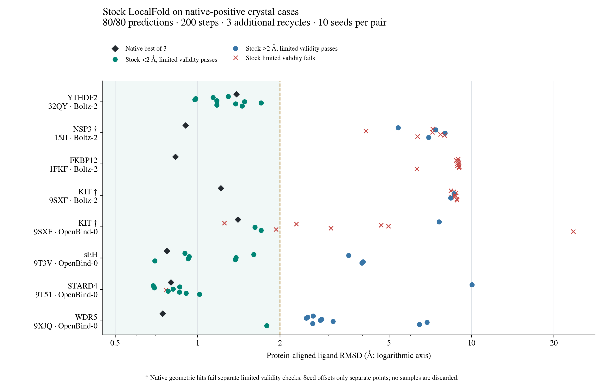

# Stock LocalFold on native-positive crystal cases

**80 of 80 planned predictions completed.** Status: `complete`.

Each system/model pair has a frozen budget of **10 model seeds, 200 diffusion steps and 3 additional recycles (4 trunk passes)**. Only cases with a previously saved same-model native pose strictly below 2 Å were selected. This is a selected diagnostic cohort, not an unbiased prospective accuracy benchmark.

| Case | Model | Native best Å | Stock <2 Å / completed | Valid stock hits | Stock best Å | Stock median Å |
| --- | --- | ---: | ---: | ---: | ---: | ---: |
| 32qy-a1keo | boltz2 | 1.39 | 10/10 | 10 | 0.98 | 1.23 |
| 15ji-a1d2g | boltz2 | 0.90 | 0/10 | 0 | 4.12 | 7.21 |
| 1fkf-fk5 | boltz2 | 0.83 | 0/10 | 0 | 6.32 | 8.92 |
| 9sxf-a1jrg | boltz2 | 1.22 | 0/10 | 0 | 8.40 | 8.67 |
| 9sxf-a1jrg | openbind0 | 1.40 | 4/10 | 2 | 1.25 | 2.68 |
| 9t3v-a1jtg | openbind0 | 0.77 | 7/10 | 7 | 0.70 | 1.38 |
| 9t51-a1jtm | openbind0 | 0.80 | 9/10 | 8 | 0.69 | 0.84 |
| 9xjq-a1e0i | openbind0 | 0.74 | 1/10 | 1 | 1.79 | 2.72 |

Native KIT (both models) and NSP3/Boltz geometric hits fail the separate limited validity checks. They remain explicit geometric diagnostics. “Valid” here means the existing stereochemical identity and severe protein–ligand clash checks; it does not assert complete physical validation.

## Pose selection and sampling

| Case | Model | Seed 0 Å | Best of first 3 Å | Highest-ipTM seed | Highest-ipTM pose Å |
| --- | --- | ---: | ---: | ---: | ---: |
| 32qy-a1keo | boltz2 | 1.29 | 0.98 | 0 | 1.29 |
| 15ji-a1d2g | boltz2 | 5.39 | 5.39 | 4 | 7.21 |
| 1fkf-fk5 | boltz2 | 8.93 | 8.79 | 9 | 6.32 |
| 9sxf-a1jrg | boltz2 | 8.41 | 8.41 | 2 | 8.79 |
| 9sxf-a1jrg | openbind0 | 7.62 | 1.25 | 0 | 7.62 |
| 9t3v-a1jtg | openbind0 | 0.90 | 0.90 | 7 | 0.70 |
| 9t51-a1jtm | openbind0 | 10.05 | 0.69 | 3 | 0.70 |
| 9xjq-a1e0i | openbind0 | 2.64 | 2.49 | 9 | 1.79 |

Best RMSD is a crystal-informed oracle statistic. Native bests use the original three saved seeds; stock bests use the completed part of the predeclared ten-seed set. The first-three statistic is shown only after all three have completed. Confidence selection uses the largest reported ipTM without consulting the crystal; ties select the lowest seed. All samples, errors and geometry diagnostics remain in [scores.json](scores.json).

## Execution and verification

The pristine LocalFold page at `5ea3d42c911949700401b54003cb28c557fcf2a6` executes its own Fold button, SMILES preparation, quantized weights, sampler and confidence head. The Molarium folding wrapper is bypassed. Actual folding devices and browser versions are recorded per prediction. This batch uses physical Apple WebGPU on the local M1 Pro; numerical settings/tuning are not overridden. Step and recycle counts are read back from the original UI. Inputs contain sequence, declared SMILES and provided alignment only, with no crystal coordinates.

All observed corresponding Cα atoms determine the protein fit. Ligand heavy-atom RMSD allows graph symmetry but no independent ligand fit, pocket fit or trimming. Archived inputs/outputs and native selection evidence are hash-checked and scores are independently recomputed when assembling this snapshot. Equal integer seeds do not imply matched native/browser random tensors. Sampling, input preparation, quantization and hardware differences prevent treating these pose tests as strict implementation parity.

Evidence archive: [part 1](evidence.part-01.bin) · [part 2](evidence.part-02.bin). The checker reassembles the parts automatically. · [Archive hashes](evidence.json)

```sh
python folding/comparison/check_stock_benchmark.py /path/to/this/review
```

## Direct agreement with native poses

Every available stock pose is compared with all three preserved native poses, after aligning each protein to the same observed crystal Cα frame. Ligands are never independently fitted. Native intrinsic spread is shown as context; equal integer seeds do not mean equal random tensors.

| Case | Model | Median nearest-native Å | Same-seed mean Å (0–2) | Native pairwise spread Å |
| --- | --- | ---: | ---: | ---: |
| 32qy-a1keo | boltz2 | 0.67 | 2.04 | 1.97 |
| 15ji-a1d2g | boltz2 | 6.99 | 6.52 | 0.96 |
| 1fkf-fk5 | boltz2 | 8.67 | 8.69 | 0.75 |
| 9sxf-a1jrg | boltz2 | 7.99 | 8.06 | 0.38 |
| 9sxf-a1jrg | openbind0 | 1.67 | 4.99 | 5.02 |
| 9t3v-a1jtg | openbind0 | 0.54 | 1.26 | 0.94 |
| 9t51-a1jtm | openbind0 | 0.42 | 3.72 | 0.24 |
| 9xjq-a1e0i | openbind0 | 1.42 | 1.73 | 2.21 |

The same-seed mean is emitted only when all of stock seeds 0, 1 and 2 are available. These are pose-agreement statistics, not a matched-tensor numerical parity result. [Every native comparison and source-library hash](native-agreement.json).

## Individual predictions


